🇪🇸 **Español** · 🇺🇸 [English (summary)](README.md)

# 🌦️ 45 años de clima en Ecuador: ¿qué cambió y cuánto podemos confiar en la respuesta?

¿Se está calentando el Ecuador? ¿Hay más olas de calor o lluvias intensas? ¿Cuánto pesa El Niño? Para responderlo extraigo **11,8 millones de registros horarios del reanálisis ERA5** (1980–2024) para **22 ciudades de la Costa, la Sierra, la Amazonía y Galápagos**, más 8 puntos donde hay estaciones de NOAA. Con eso calculo tendencias con **Mann-Kendall corregido por autocorrelación y pendiente de Sen**, anomalías respecto a 1981–2010, **14 índices de extremos** del ETCCDI y la relación con El Niño con rezagos. Al final valido ERA5 contra **estaciones de superficie** para saber en qué se puede confiar y en qué no.


---

## 📌 Preguntas que responde

| # | Pregunta | Técnica | Respuesta |
|---|---|---|---|
| 1 | ¿Se calienta el Ecuador? | Mann-Kendall + Hamed-Rao, pendiente de Sen, FDR | **Sí: +0,24 °C por década** (p = 0,002), **+1,06 °C desde 1980**. Significativo en 18 de 22 ciudades (no en Galápagos, Salinas ni Portoviejo) |
| 2 | ¿Se calientan más los días o las noches? | Tendencias de Tmáx y Tmín | **Las noches**: Tmín sube con significancia en 19 ciudades (todas siguen siéndolo con FDR) y Tmáx en 12 (solo 6 sobreviven a FDR) |
| 3 | ¿Aumentan las olas de calor? | Índices ETCCDI con umbrales propios de cada ciudad | **Sí: de 13 a 52 días al año** en olas de calor (1981–90 vs 2015–24). Sierra: +8,3 días por década |
| 4 | ¿Llueve más o menos? | Tendencias de lluvia y de 9 índices de lluvia extrema | **Sin cambio claro**: 18 de 22 ciudades sin tendencia. En la Amazonía, menos días de lluvia pero más intensos |
| 5 | ¿Cuánto pesa El Niño y con qué anticipación? | Correlaciones con rezago y tamaño de muestra efectivo | Temperatura: r = 0,70 en Galápagos y 0,60 en la Costa; la Sierra y la Amazonía responden **2–3 meses después**. El Niño **seca la Sierra** |
| 6 | ¿El ONI anticipa las lluvias de la Costa? | ONI vs Niño 1+2 por temporada lluviosa | **No tanto como se cree**: 2015-16 tuvo el ONI récord y lluvia normal. La lluvia de ene–abr se explica mucho mejor con **Niño 1+2 (r = 0,84) que con el ONI (r = 0,43)** |
| 7 | ¿Se puede confiar en ERA5 en los Andes? | Validación contra 8 estaciones NOAA GHCN-Daily | **Para la variabilidad de la temperatura (anomalías, extremos relativos), sí; para valores absolutos y totales de lluvia, no**: errores de ×0,3 a ×4,6 y lluvia casi todos los días. Las pendientes de largo plazo no se pudieron contrastar con estaciones |

## 🏗️ Arquitectura

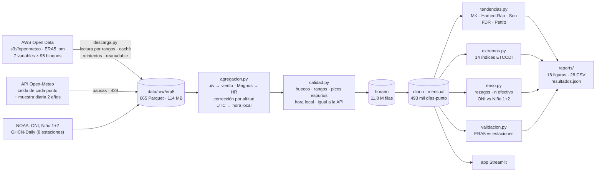

Un comando ejecuta todo: `python descargar_datos.py` (20–40 min la primera vez) y `python -m clima_ecuador.pipeline --sin-descarga` (~50 s).

## 🧹 Ingeniería de datos

| Problema real | Solución |
|---|---|
| La API gratuita pondera cada petición por `días/14 × variables/10`: 45 años × 22 ciudades × 7 variables ≈ **25 000 llamadas**, y el límite es **10 000 por día** (compartido por la IP) | El mismo ERA5 de Open-Meteo está en **AWS Open Data** en formato `.om`. Con `omfiles` + `s3fs` anónimo leo **solo los bytes de cada punto** de archivos de 4 GB: 665 bloques en ~30 min, sin límite de llamadas |
| La PC se apagó dos veces en plena descarga | Escritura **atómica** (`.tmp` → renombrar) y validación de cada bloque al reanudar (se lee, tiene 30 columnas y ≥ 504 horas): se saltaron 643 bloques válidos y se bajaron 22 |
| ¿Mi agregación diaria es correcta? | La comparo con la **API diaria** en 16 060 días: lluvia y radiación **0,000 de diferencia**, Tmed 0,025 °C (redondeo) |
| La lluvia diaria no cuadraba (0,15–0,60 mm/día) | La lluvia de la hora *t* es la de la hora que **termina** en *t*: el día suma de 01:00 a 24:00. Con eso, diferencia 0 |
| Con `elevation=nan` la API elige **otra celda** en 3 ciudades | La muestra se pide en el centro de la celda exacta con `cell_selection=nearest` |
| **Picos de viento de 255 km/h** con ráfagas de 17 km/h en Guayaquil | Imposible (el viento medio no supera a la ráfaga): 209 horas (0,002 %) anuladas; **195 caen a las 08–09 UTC**, un artefacto del reanálisis |
| La celda de 25 km no está a la altitud de la ciudad (Riobamba: 2 754 m vs 3 684 m) | Corrección de la temperatura con −6,5 °C/km, la misma idea que usa Open-Meteo |
| Galápagos: las islas son más pequeñas que una celda | ERA5 las trata como mar. Se marca (`celda_mar`) y se explica en la validación |
| ¿Salto artificial en el reanálisis? | Test de **Pettitt sobre la serie sin tendencia**: 0 de 22 ciudades con salto significativo |
| Hora local: Ecuador continental UTC−5, Galápagos UTC−6 | Control: el pico de radiación cae a las 12–13 h locales en todas las regiones |

## 📊 Resultados

### 1 · El Ecuador se calienta +0,24 °C por década

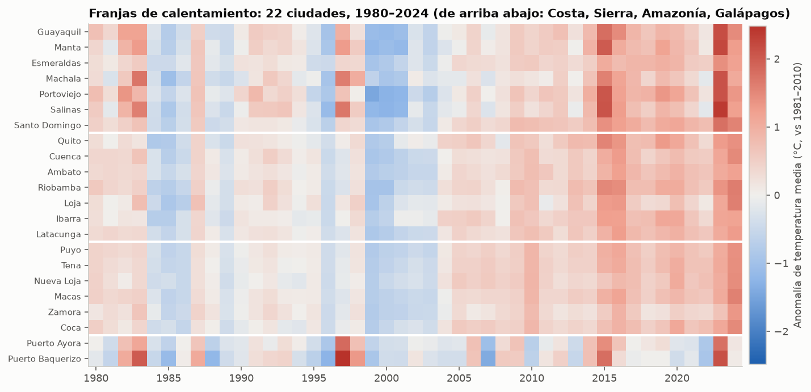

| Región | Tmed (°C/década) | IC 95 % | p (Hamed-Rao) | Tmáx | Tmín |
|---|---:|---|---:|---:|---:|
| **Ecuador (22 ciudades)** | **+0,24** | — | **0,002** | +0,23 | +0,18 |
| Sierra | +0,27 | 0,13 a 0,41 | 0,0004 | +0,26 | +0,18 |
| Costa | +0,26 | 0,05 a 0,47 | 0,011 | +0,21 (n.s.) | +0,24 |
| Amazonía | +0,24 | 0,11 a 0,35 | 0,0006 | +0,22 | +0,18 |
| Galápagos | +0,05 | −0,12 a 0,22 | 0,50 | n.s. | n.s. |

* **+1,06 °C en 45 años.** Los 4 años más cálidos son **2023, 2015, 2024 y 2016**: todos con El Niño encima de la tendencia.
* La ciudad que más se calienta es **Santo Domingo (+0,35 °C/década)**, seguida de Quito (+0,33) e Ibarra (+0,31).
* **Galápagos no tiene tendencia significativa**: su temperatura la domina El Niño y su celda de ERA5 es océano.

| Tendencia por ciudad (Sen + IC 95 %) | Mapa de tendencias |
|---|---|
| 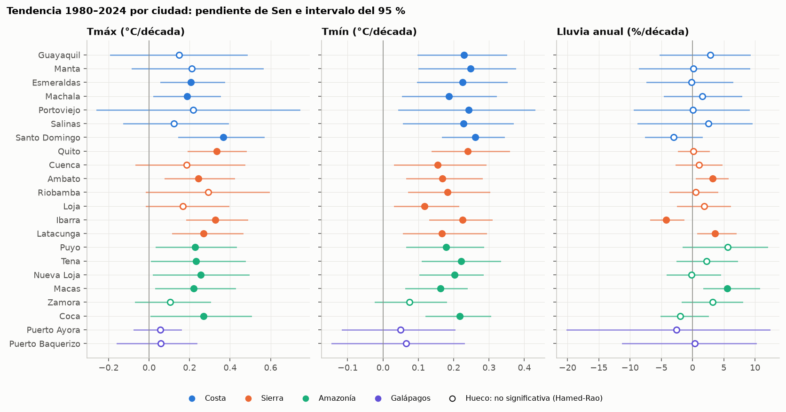 | 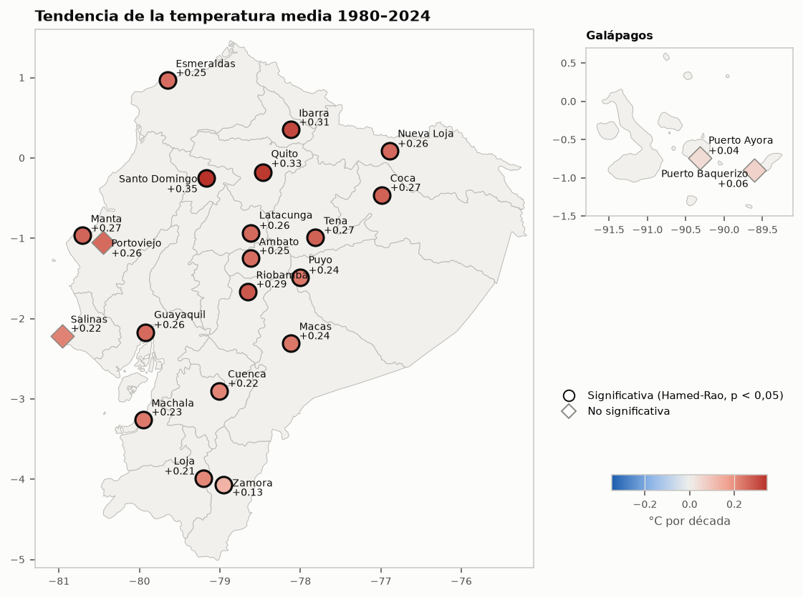 |

**Por qué importa corregir la autocorrelación.** Un año cálido suele seguir a otro, y eso hace que el Mann-Kendall original declare "significativo" de más. Con Hamed-Rao, **Salinas y Portoviejo pierden la significancia** (20 → 18 ciudades). En Galápagos el factor de corrección sale < 1 por el ciclo de El Niño y haría el test *más* permisivo (Tmín de Puerto Ayora: p 0,49 → 0,07), así que la corrección se aplica **solo cuando es conservadora** (factor ≥ 1). Las 18 ciudades siguen significativas tras corregir por pruebas múltiples (Benjamini-Hochberg).

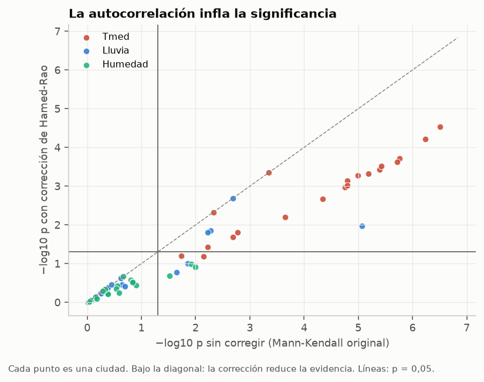

### 2 · Olas de calor: 4 veces más días que en los 80

| Promedio de 22 ciudades | 1981–1990 | 2015–2024 | Cambio |
|---|---:|---:|---:|
| Días cálidos (% con Tmáx > p90) | 10,6 % | 27,3 % | ×2,6 |
| Noches cálidas (% con Tmín > p90) | 9,4 % | 32,7 % | ×3,5 |
| **Días en olas de calor** (≥ 3 días seguidos sobre p90) | **13** | **52** | **×3,9** |
| Olas de calor por año | 2,7 | 10,4 | ×3,9 |
| Lluvia en días muy húmedos (R95pTOT, mm) | 435 | 567 | +30 % |
| Racha seca más larga (días) | 30,4 | 30,9 | sin cambio |

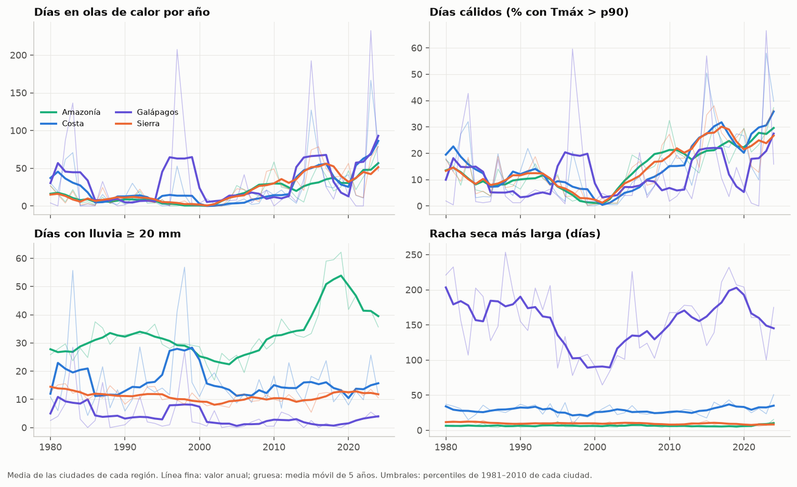

* Tendencias significativas de calor extremo en la **Sierra** (todos los índices; olas de calor +8,3 días/década) y la **Amazonía**; en la Costa, las noches cálidas.
* **Lluvia extrema:** sin tendencias en la Costa, la Sierra ni Galápagos. En la **Amazonía, menos días de lluvia (−4,4/década) pero más intensos (Rx1day +4,5 mm/década)**. Con un aviso: entre 2017 y 2019 ERA5 muestra un pulso de lluvia en las 6 ciudades amazónicas (Coca: 5 051 mm en 2018 frente a ~3 400 habituales) que las estaciones no permiten confirmar porque tienen huecos justo en esos años.

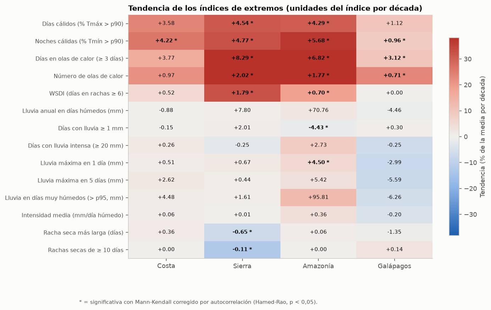

### 3 · El Niño: lo que importa es el mar frente a la costa

| Episodio de El Niño fuerte (ONI ≥ 1,5) | ONI máx. | Lluvia de la Costa | Lluvia de Galápagos | Anomalía Tmed Costa |
|---|---:|---:|---:|---:|
| 1982-10 a 1983-03 | 2,14 | **349 %** de la normal | 838 % | +1,4 °C |
| 1997-08 a 1998-02 | 2,37 | **414 %** | 685 % | +1,4 °C |
| 2015-08 a 2016-03 | **2,59** | **100 %** | 128 % | +1,7 °C |
| 2023-09 a 2024-02 | 1,99 | **83 %** | 205 % | +1,9 °C |

El ONI (Pacífico central) récord de 2015-16 **no trajo inundaciones** a la Costa. Lo que las trae es que se caliente el mar **frente a la costa** (región Niño 1+2):

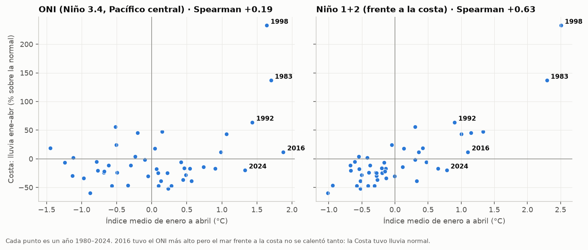

| Lluvia de enero a abril (45 años) | r con ONI | r con Niño 1+2 |
|---|---:|---:|
| Costa | 0,43 (Spearman 0,19, n.s.) | **0,84** (Spearman 0,63, p < 0,001) |
| Galápagos | 0,47 | **0,76** |
| Sierra | **−0,33** (Spearman −0,41) | 0,00 |

* La **temperatura** responde a El Niño en todo el país: r = 0,70 en Galápagos y 0,60 en la Costa sin rezago; en la **Sierra (r = 0,55) y la Amazonía (0,43) con 2–3 meses de retraso**: una alerta temprana útil.
* **El Niño seca la Sierra** (r = −0,22 con la lluvia mensual; −0,41 en ene–abr), por vía atmosférica, no del mar costero.
* Las correlaciones se prueban con **tamaño de muestra efectivo**: 540 meses autocorrelacionados equivalen a 35–380 datos independientes. Sin esa corrección, la lluvia amazónica saldría "significativa" (p = 0,035 frente a 0,13).

| Rezagos | Lluvia de la Costa y ONI |
|---|---|
| 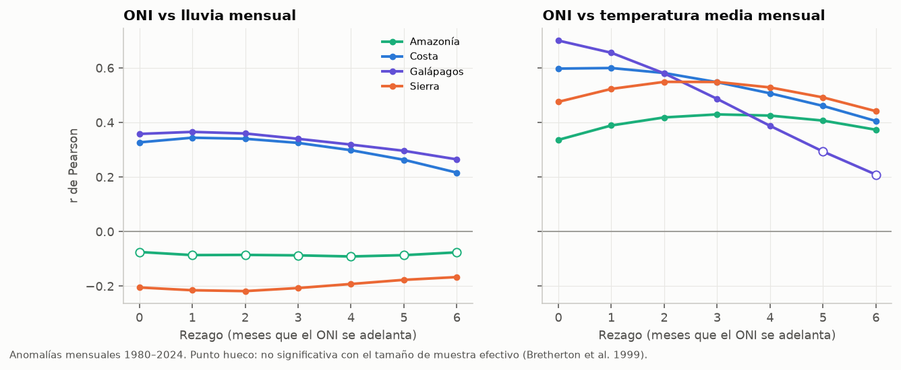 | 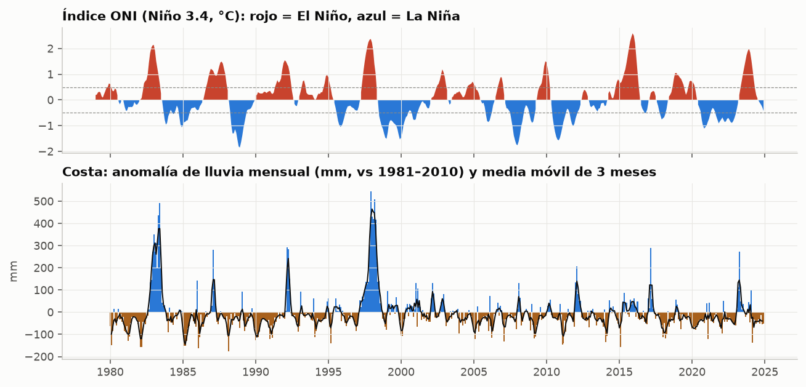 |

### 4 · Estacionalidad

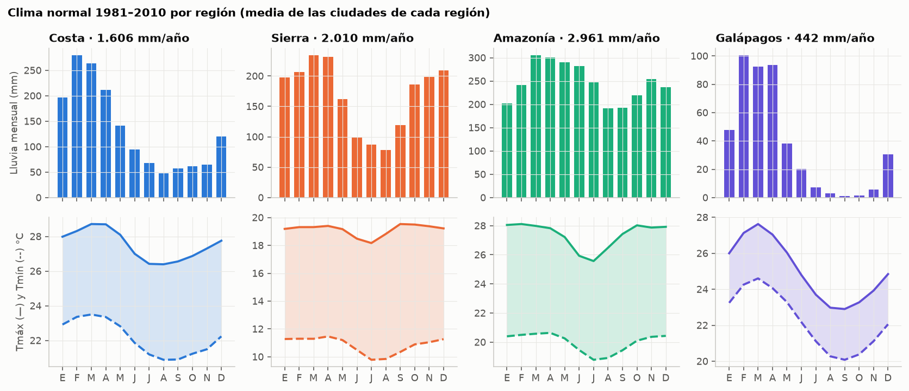

| Región (normal 1981–2010) | Lluvia (mm/año) | Tmáx | Tmín | Régimen |
|---|---:|---:|---:|---|
| Costa | 1 606 | 27,5 °C | 22,1 °C | Una estación lluviosa (feb–abr): 59 % de la lluvia en 4 meses |
| Sierra | 2 010* | 19,1 °C | 10,8 °C | **Bimodal** (mar–abr y oct–dic) |
| Amazonía | 2 961 | 27,4 °C | 20,0 °C | Llueve todo el año |
| Galápagos | 442 | 25,0 °C | 22,2 °C | La más estacional: 76 % en 4 meses |

\* Sobreestimado por ERA5 (ver validación). Con los **datos horarios**: en la Sierra y la Amazonía la lluvia es convectiva de la tarde (pico a las 12–14 h) y la amplitud térmica diaria de la Sierra (≈ 7 °C) triplica la de Galápagos ([figura](reports/figures/04_ciclo_diurno.png)).

### 5 · Validación: en qué confiar de ERA5

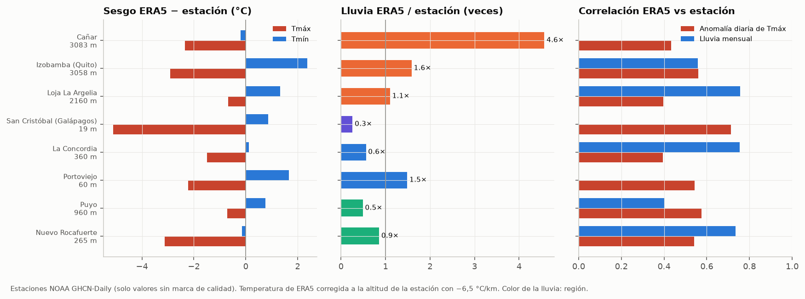

| Estación (GHCN-Daily) | Altitud | Sesgo Tmáx | Sesgo Tmín | r anomalías Tmáx | Lluvia ERA5 / estación | Días con lluvia ERA5 vs estación |
|---|---:|---:|---:|---:|---:|---:|
| Izobamba (Quito) | 3 058 m | −2,9 °C | +2,4 °C | 0,56 | **×1,6** | 98 % vs 67 % |
| Cañar | 3 083 m | −2,3 °C | −0,2 °C | 0,43 | **×4,6** | 86 % vs 46 % |
| Loja La Argelia | 2 160 m | −0,7 °C | +1,3 °C | 0,40 | ×1,1 | 64 % vs 57 % |
| Puyo | 960 m | −0,7 °C | +0,8 °C | 0,58 | ×0,5 | 85 % vs 77 % |
| La Concordia | 360 m | −1,5 °C | +0,1 °C | 0,39 | ×0,6 | 75 % vs 58 % |
| San Cristóbal (Galápagos) | 19 m | **−5,1 °C** | +0,9 °C | 0,71 | ×0,3 | 12 % vs 27 % |

* ERA5 **aplana el ciclo diario** en la montaña (Tmáx más baja, Tmín más alta): una celda de 25 km promedia valles, laderas y páramo.
* En Galápagos la celda es **mar**: no reproduce el calentamiento diurno de la isla (−5 °C en Tmáx).
* Las **anomalías diarias** se siguen razonablemente bien (r = 0,39–0,71): ERA5 sirve para **variabilidad y extremos relativos**, no para valores absolutos. Lo validado son los sesgos y esa correlación; **la pendiente de largo plazo no se contrastó con las estaciones** (ninguna tiene 10 años con ≥ 300 días al año), así que las tendencias de este proyecto son las del reanálisis, con sus límites.
* La **lluvia** falla en cantidad (×0,3 a ×4,6) y en frecuencia (llovizna casi diaria en los Andes), aunque acierta los meses más lluviosos (r mensual 0,40–0,76).

> **Limitaciones:** solo 8 estaciones GHCN con datos recientes (el INAMHI no publica sus series en un formato abierto descargable), con huecos largos; ERA5 es un modelo, no una observación; la corrección por altitud con un gradiente fijo es una aproximación. **Mejoras:** ERA5-Land (0,1°) para temperatura, CHIRPS para lluvia, corrección de sesgo por cuantiles con estaciones del INAMHI.

## 🖥️ App interactiva

`streamlit run app/streamlit_app.py`: elige ciudad, variable y periodo. Calcula al vuelo la tendencia de Sen con Mann-Kendall corregido, el ciclo anual, la correlación con El Niño por rezago y los extremos (primeros 10 años frente a los últimos 10). Acepta enlaces como `?ciudad=Cuenca&variable=precip&desde=1990&hasta=2024`.

| Quito, temperatura | Guayaquil, lluvia | Puerto Ayora, Tmáx 1990–2024 |
|---|---|---|
| 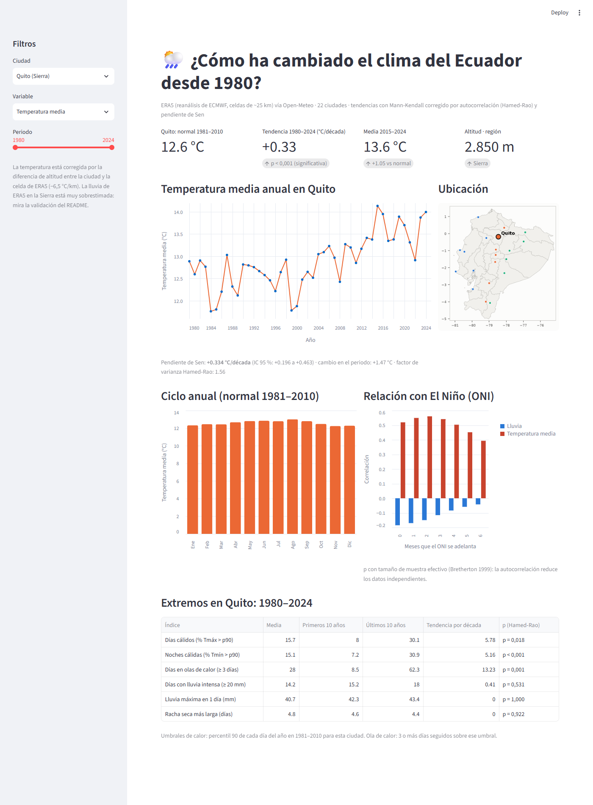 | 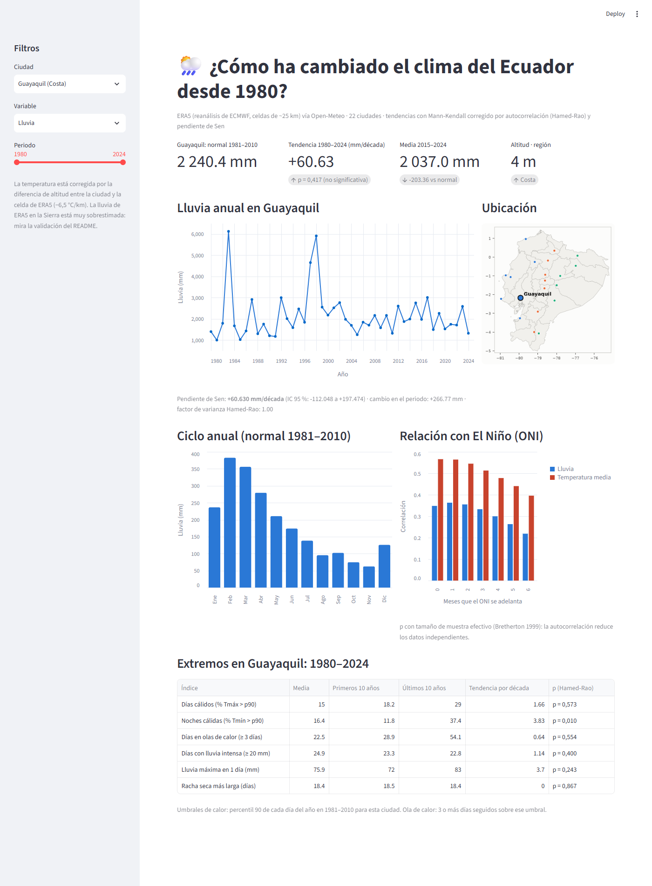 | 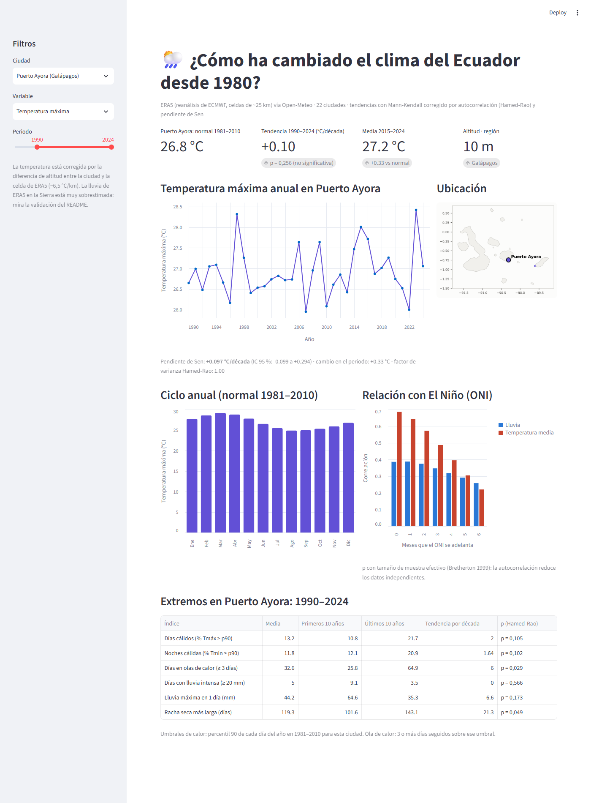 |

## 📓 Notebooks (ejecutados, con resultados)

1. [Descarga y controles de calidad](notebooks/01_descarga_y_calidad.ipynb): por qué S3 y no la API, celdas, picos espurios, comparación exacta con la API
2. [Clima normal y estacionalidad](notebooks/02_climatologia_y_estacionalidad.ipynb): climatología por región, régimen bimodal de la Sierra, ciclo diario con datos horarios
3. [Tendencias y anomalías](notebooks/03_tendencias_y_anomalias.ipynb): Mann-Kendall paso a paso, Hamed-Rao vs Yue-Wang, FDR, Pettitt
4. [Eventos extremos](notebooks/04_extremos.ipynb): 14 índices ETCCDI, olas de calor, lluvia intensa, rachas secas
5. [El Niño](notebooks/05_el_nino.ipynb): rezagos, tamaño efectivo, episodios fuertes, ONI frente a Niño 1+2
6. [Validación de ERA5](notebooks/06_validacion_era5.ipynb): sesgos, lluvia, qué usar y qué no

## 🧠 Decisiones técnicas

* **Un solo modelo, ERA5 a 0,25°, para los 45 años.** El modelo por defecto de la API (`best_match`) mezcla ERA5, ERA5-Land y el IFS de 9 km desde 2017: un cambio de resolución a mitad de la serie crearía tendencias falsas.
* **Mann-Kendall + Sen** en vez de regresión lineal: no supone normalidad y los años de El Niño no arrastran la pendiente.
* **Hamed-Rao con piso 1:** corrige la autocorrelación positiva (la que infla la significancia) sin volver el test más permisivo cuando hay autocorrelación negativa. Yue-Wang da un factor de 0,50 en Quito: lo descarté por eso.
* **Umbrales de extremos propios de cada ciudad y día del año** (percentil 90 de 1981–2010, ventana de 5 días): así los sesgos absolutos de ERA5 se cancelan.
* **Tamaño de muestra efectivo** en todas las correlaciones con El Niño: sin él, casi cualquier correlación sale significativa.
* **Regiones = media simple de sus ciudades**: cada ciudad pesa igual (no hay un área ni una población que ponderar con 22 puntos).
* **Verificar antes de analizar:** la agregación propia se compara con la API en 16 060 días; los picos de viento se detectan con una regla física (viento > ráfaga + 20 km/h).

## 🚀 Cómo ejecutarlo

Guía detallada para Windows, con preguntas de entrevista: **[docs/GUIA_PASO_A_PASO.md](docs/GUIA_PASO_A_PASO.md)**

```bash
python -m venv .venv && .venv\Scripts\activate
pip install -r requirements.txt
pip install -e .
python descargar_datos.py                          # ERA5, ONI, Niño 1+2, GHCN, provincias (20–40 min, reanudable)
python -m clima_ecuador.pipeline --sin-descarga    # series, análisis, 18 figuras y resultados.json (~50 s)
pytest                                             # 42 pruebas
streamlit run app/streamlit_app.py                 # funciona con las tablas versionadas, sin descargar nada
```

## 📁 Estructura

```
├── descargar_datos.py          descarga desde las fuentes oficiales a data/raw (caché reanudable)
├── src/clima_ecuador/
│   ├── config.py               22 ciudades, 8 estaciones, variables, periodos, paleta
│   ├── descarga.py             S3 (.om) con lectura por rangos, API con pausas y 429, ONI, Niño 1+2, GHCN
│   ├── agregacion.py           horario → diario (hora local) → mensual → anual; viento, humedad, altitud
│   ├── calidad.py              completitud, huecos, rangos, picos espurios, hora local, comparación con la API
│   ├── clima.py                climatología 1981–2010, anomalías, ciclo diario, estacionalidad
│   ├── tendencias.py           Mann-Kendall, Hamed-Rao, Yue-Wang, Sen, Benjamini-Hochberg, Pettitt
│   ├── extremos.py             14 índices ETCCDI por ciudad y año
│   ├── enso.py                 rezagos, tamaño efectivo, compuestos, episodios, ONI vs Niño 1+2
│   ├── validacion.py           ERA5 vs estaciones GHCN-Daily
│   ├── graficos.py             18 figuras y mapas (GeoJSON de provincias, sin dependencias GIS)
│   └── pipeline.py             orquestador
├── notebooks/                  6 notebooks ejecutados
├── app/streamlit_app.py        explorador por ciudad
├── tests/                      42 pruebas (contraste con pymannkendall, datos sintéticos, datos reales, app)
├── data/procesados/            tablas diarias, mensuales e índices (versionadas, 9,6 MB)
└── reports/                    figuras, capturas, 28 CSV y resultados.json
```

## 📚 Fuentes y licencias

* **ERA5** (Copernicus Climate Change Service / ECMWF), servido por **[Open-Meteo](https://open-meteo.com/)**: [Historical Weather API](https://open-meteo.com/en/docs/historical-weather-api) y su archivo en [AWS Open Data](https://registry.opendata.aws/open-meteo/) (`s3://openmeteo/data/copernicus_era5/`). Datos de Open-Meteo bajo [CC BY 4.0](https://creativecommons.org/licenses/by/4.0/); ERA5 bajo la licencia de Copernicus. Hersbach et al. (2020), *The ERA5 global reanalysis*, QJRMS.
* **ONI** y **Niño 1+2**: NOAA PSL ([oni.data](https://psl.noaa.gov/data/correlation/oni.data), [nina1.anom.data](https://psl.noaa.gov/data/correlation/nina1.anom.data)), dominio público.
* **GHCN-Daily**: NOAA NCEI ([acceso por estación](https://www.ncei.noaa.gov/data/global-historical-climatology-network-daily/access/)), dominio público.
* **Límites provinciales**: [geoBoundaries](https://www.geoboundaries.org/) (ECU ADM1), CC0.
* Métodos: Mann (1945), Kendall (1975), Sen (1968), Hamed y Rao (1998), Yue y Wang (2004), Benjamini y Hochberg (1995), Pettitt (1979), Bretherton et al. (1999), índices ETCCDI (Zhang et al. 2011).

Datos descargados en octubre de 2026.

**Licencia:** el **código** de este repositorio es [MIT](LICENSE) (© 2026 Erick Guarnizo); los **datos** siguen la licencia propia de cada fuente, la citada arriba.

## 👤 Autor

**Erick Guarnizo** · Ingeniero en Sistemas · [LinkedIn](https://www.linkedin.com/in/erick-g-571a7b3b4)
