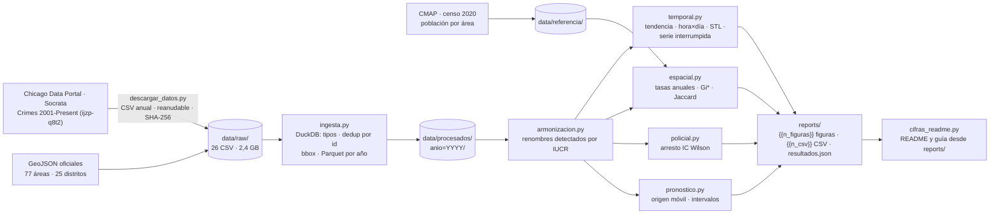

🇪🇸 **Español** · 🇺🇸 [English (summary)](README.md)

# Delitos en Chicago 2001–{{anio_completo}}: dónde se concentran, cómo cambiaron y cuánto se puede anticipar

¿Dónde y cuándo se concentran los delitos de Chicago? ¿Cuánto cambiaron con la pandemia? ¿Qué zonas tienen más delitos por habitante y cuánto se puede anticipar la demanda por distrito? Para responderlo proceso **{{registros_totales}} registros reales del Chicago Data Portal** (enero de 2001 al {{ultimo_dato}}) con **DuckDB + Parquet**, y los analizo con pandas, statsmodels, geopandas y esda: tendencia anual, patrón hora × día, descomposición **STL**, una **serie temporal interrumpida** para el COVID-19, **tasas anuales por 100 mil habitantes** en las 77 áreas comunitarias, **hotspots Getis-Ord Gi\*** con su estabilidad año a año, tasas de arresto con **IC de Wilson** y un **pronóstico mensual por distrito** evaluado con **backtesting de origen móvil** e intervalos de predicción.


> **Años completos y año parcial.** Los totales, rankings y tasas usan solo años completos (2001–{{anio_completo}}, {{registros_completos}} registros). {{anio_parcial}} tiene datos hasta el {{ultimo_dato}} ({{registros_parcial}} registros): aparece marcado como parcial en la tendencia y solo entra al pronóstico hasta su último mes completo ({{ultimo_mes_completo}}).

---

## Preguntas que responde

| # | Pregunta | Técnica | Respuesta |
|---|---|---|---|
| 1 | ¿Los delitos están bajando? | Tendencia anual (años completos) | **Sí**: de {{delitos_max}} ({{anio_max}}) a {{delitos_ultimo_completo}} ({{anio_completo}}), {{caida_max_a_ultimo_pct}} %; mínimo de {{delitos_min}} en {{anio_min}} |
| 2 | ¿Qué cambió entre 2019 y 2024? | Variación por tipo con **categorías armonizadas** | Robo de vehículos **{{cambio_mvt}} %**; narcóticos **{{cambio_narc}} %**. La agresión sexual criminal **no** subió {{cs_nuevo_cambio}} %: fue un cambio de nombre ({{cs_arm_cambio}} % al armonizar) |
| 3 | ¿Cuándo ocurren? | Mapa de calor hora × día + STL | Franja de más actividad **{{franja_ini}}–{{franja_fin}}** ({{franja_pct}} % de los delitos), mínimo a las {{hora_minima}}; pico estacional en {{mes_alto}} |
| 4 | ¿Cuánto cambió con el COVID-19? | Serie interrumpida con contrafactual ajustado antes de 2020 | **{{covid_cambio}} %** entre {{covid_ini}} y {{covid_fin}} (IC 95 %: {{covid_cambio_inf}} a {{covid_cambio_sup}} %): {{covid_diferencia}} delitos menos de lo esperado |
| 5 | ¿Qué zonas tienen más delito por habitante? | Tasa **anual** por 100 mil hab., {{ventana}} | **{{area_tasa_1}}** ({{area_tasa_1_tasa}} por 100 mil al año). Austin es la 1.ª en volumen pero la {{austin_tasa}}.ª en tasa |
| 6 | ¿Los hotspots son estables? | **Getis-Ord Gi\*** en grilla de 1 km + índice de Jaccard | **Sí**: Jaccard medio entre años consecutivos {{gi_jaccard_medio}}; {{gi_persistentes}} celdas son hotspot los {{n_anios_ventana}} años |
| 7 | ¿Cuál es la tasa de arresto? | IC de Wilson al 95 % por tipo | **{{arresto_global}} %** global; > 99 % en narcóticos y prostitución, < 8 % en robo de vehículo y robo a vivienda |
| 8 | ¿Se puede anticipar la demanda por distrito? | Backtesting de origen móvil ({{pron_cortes}} cortes) | **Sí**: {{pron_ganador}} con WAPE {{pron_wape}} % frente a {{pron_base}} % de la base estacional; intervalo del 90 % con cobertura real de {{pron_cobertura}} % |

## Arquitectura



Dos comandos: `python descargar_datos.py` (descarga reanudable, unos 30 min la primera vez) y `python -m delitos_chicago.pipeline` (análisis completo, {{tiempo_pipeline}} s con el Parquet ya creado). Después, `python -m delitos_chicago.cifras_readme` vuelve a escribir este README con las cifras de `reports/`.

## Ingeniería y calidad de datos

| Problema real | Solución |
|---|---|
| 2,4 GB de CSV no caben cómodos en pandas | **DuckDB** lee los 26 CSV, normaliza tipos, deduplica por `id` ({{duplicados}} duplicados) y escribe **Parquet particionado por año**. El pipeline carga solo las columnas que usa |
| Un tipo de delito cambió de nombre a mitad de la serie | **Armonización detectada con datos** (ver abajo): `CRIM SEXUAL ASSAULT` → `CRIMINAL SEXUAL ASSAULT` |
| El año en curso está incompleto | Se excluye de totales, tasas y rankings; se marca en la tendencia; el pronóstico corta en {{ultimo_mes_completo}} |
| Coordenadas desplazadas a nivel de cuadra (privacidad) | Válidas para agregar en áreas y celdas de 1 km, no para puntos exactos. {{fuera_chicago}} filas caen fuera del rectángulo de Chicago |
| {{sin_coordenadas}} registros ({{pct_sin_coordenadas}} %) sin coordenadas | Se usan en el análisis temporal y policial y se excluyen solo del espacial |
| Trazabilidad de la fuente | [`data/manifiesto_fuente.json`](data/manifiesto_fuente.json) registra {{archivos_manifiesto}} archivos con URL de descarga, fecha, filas, bytes y **SHA-256** |
| Tasas de arresto cerca de 0 o 1 | **Intervalo de Wilson** en vez de Wald |

### Control de calidad: un salto de {{cs_nuevo_cambio}} % que era un cambio de nombre

Al comparar 2019 con 2024, `CRIMINAL SEXUAL ASSAULT` pasa de {{cs_nuevo_ini}} a {{cs_nuevo_fin}} ({{cs_nuevo_cambio}} %). Pero `CRIM SEXUAL ASSAULT` pasa de {{cs_viejo_ini}} a {{cs_viejo_fin}} en el mismo periodo: la policía cambió la etiqueta. Sumadas, pasan de **{{cs_arm_ini}} a {{cs_arm_fin}} ({{cs_arm_cambio}} %)**.

En lugar de corregir este caso a mano, [`armonizacion.py`](src/delitos_chicago/armonizacion.py) busca las categorías que dejan de aparecer y comprueba si sus **códigos IUCR** (el código de delito de Illinois, que no depende de la etiqueta) siguen registrándose después bajo otra categoría. `CRIM SEXUAL ASSAULT` usa {{cs_codigos_iucr}} códigos IUCR y, después de {{cs_ultimo_anio}}, el {{cs_cobertura}} % de sus registros corresponde a códigos que aparecen bajo `CRIMINAL SEXUAL ASSAULT`. La tabla se aplica a **todo** el análisis ([`reports/armonizacion_categorias.csv`](reports/armonizacion_categorias.csv)):

{{tabla_armonizacion}}

## Resultados

### 1 · El delito registrado cayó a la mitad y cambió de composición


{{tabla_tendencia}}

* La caída desde el máximo de {{anio_max}} es de **{{caida_max_a_ultimo_pct}} %** hasta {{anio_completo}}. 2020 cayó **{{caida_2020_vs_2019_pct}} %** frente a 2019, y la serie repuntó en 2022–2023.

{{tabla_cambio}}

*Tabla completa en [`reports/cambio_porcentual_2019_2024.csv`](reports/cambio_porcentual_2019_2024.csv), ya con las categorías armonizadas.* El robo de vehículos más que se duplica; este análisis describe el aumento registrado, pero no identifica su causa. Narcóticos ({{cambio_narc}} %) y juego ilegal ({{cambio_juego}} %) son delitos que casi solo se registran cuando hay un arresto, así que reflejan sobre todo la actividad policial. Por eso no conviene leer esas series como incidencia.

### 2 · COVID-19: serie temporal interrumpida

Ajusté un modelo **solo con datos de {{covid_pre_ini}} a {{covid_pre_fin}}** ({{covid_meses_pre}} meses): logaritmo de la media diaria de delitos por mes con tendencia lineal y estacionalidad mensual. El error del ajuste antes de la pandemia es {{covid_mape_pre}} % (MAPE) y la tendencia previa, {{covid_tendencia_pre}} % al año. Con ese modelo proyecté un **contrafactual** para {{covid_ini}}–{{covid_fin}} con intervalos de predicción del 95 %, simulando la incertidumbre de los coeficientes y la variación mes a mes.


* Se registraron **{{covid_observado}} delitos** frente a **{{covid_contrafactual}}** esperados: **{{covid_cambio}} %** (IC 95 %: {{covid_cambio_inf}} a {{covid_cambio_sup}} %), unos {{covid_diferencia}} delitos menos (entre {{covid_dif_inf}} y {{covid_dif_sup}}). {{covid_fuera}} de los {{covid_meses}} meses evaluados quedan fuera del intervalo de predicción.
* La caída no fue igual para todos los tipos ([`reports/covid_por_serie.csv`](reports/covid_por_serie.csv)):

{{tabla_covid}}

* Frente al contrafactual, en el confinamiento (abril–mayo de 2020) el hurto quedó en **{{covid_choque_hurto}} %** y la violencia doméstica registrada en **{{covid_choque_domestica}} %**, mientras que el robo a vivienda o local quedó en **{{covid_choque_burglary}} %** en esos dos meses y el robo de vehículo cerró el periodo en **{{covid_mvt}} %**. El modelo de narcóticos ajusta mal antes de 2020 (error {{covid_mape_narc}} %), así que su intervalo es poco fiable.
* Es una comparación contra lo esperado según la tendencia, no un efecto causal aislado: en 2020 coincidieron el confinamiento, las protestas de mayo–junio y cambios en el patrullaje.

### 3 · Cuándo ocurren: hora, día y estación


* La franja de cuatro horas con más delitos es **{{franja_ini}}–{{franja_fin}}**, con el {{franja_pct}} % del total (si el reparto fuera uniforme sería {{franja_esperado_pct}} %). El mínimo cae a las **{{hora_minima}}**. Las 00:00 concentran el {{pct_medianoche}} % de los registros, en buena parte porque los incidentes sin hora exacta se guardan con esa hora, así que la medianoche no se usa para buscar la franja pico.
* El **{{dia_max}}** es el día con más delitos y el **{{dia_min}}**, el de menos; la diferencia es de {{dif_dias}} %.
* La descomposición **STL** del hurto mensual separa la tendencia del ciclo anual: el máximo estacional cae en **{{mes_alto}}** y el mínimo en **{{mes_bajo}}**, con una amplitud de {{amplitud_estacional}} % de la media mensual.


### 4 · Tipos de delito más frecuentes


{{tabla_top_tipos}}

### 5 · Dónde: tasa anual por habitante frente a volumen

La tasa es **anual**: delitos de cada año entre la población del área (censo 2020, [CMAP](data/referencia/poblacion_areas_cmap_2020.csv)), promediada en {{ventana}}. Ranking por tasa ([`reports/delitos_por_area_comunitaria.csv`](reports/delitos_por_area_comunitaria.csv); serie por año en [`reports/tasas_anuales_area.csv`](reports/tasas_anuales_area.csv)):


**Mapas interactivos** (Folium, un HTML cada uno en `reports/`): [`mapa_chicago_coropleta.html`](reports/mapa_chicago_coropleta.html) muestra la tasa anual por área comunitaria con un cuadro al pasar el ratón, y [`mapa_calor_hotspots.html`](reports/mapa_calor_hotspots.html) un mapa de calor sobre 12.000 puntos al azar. GitHub no ejecuta HTML: descarga el archivo y ábrelo con doble clic en el navegador (necesita conexión a internet para las teselas de OpenStreetMap). Se regeneran con `python -m delitos_chicago.pipeline`.

{{tabla_areas_tasa}}

El ranking por **volumen** cuenta otra historia: las áreas más pobladas o con mucha población flotante encabezan la lista, aunque su tasa sea media.

{{tabla_areas_volumen}}


* **Austin** tiene el mayor volumen ({{austin_delitos}} delitos al año), pero con {{austin_poblacion}} habitantes su tasa ({{austin_tasa_valor}} por 100 mil) lo deja en el puesto {{austin_tasa}}. Comparar áreas por conteo confunde tamaño con riesgo.
* El ranking de tasas es persistente: en las 10 primeras áreas, la desviación estándar mediana del puesto año a año es {{areas_rank_desv_mediana_top10}}. La excepción es **{{areas_rank_desv_max_area}}** (desviación {{areas_rank_desv_max_top10}}, del puesto {{areas_rank_desv_max_mejor}} al {{areas_rank_desv_max_peor}}): su tasa depende de la población flotante del centro, que se desplomó en 2020–2021.

### 6 · Hotspots estadísticos: Getis-Ord Gi\*

Un ranking de áreas no dice si una concentración es estadísticamente significativa. Para eso calculé **Getis-Ord Gi\*** (con `esda`) sobre una **grilla de 1 km** ({{gi_celdas}} celdas con delitos), con vecindad de tipo reina, para cada año de {{ventana}}. Usé la p bilateral con **corrección FDR de Benjamini-Hochberg** al 5 % para no inflar los hotspots con miles de pruebas. La estabilidad se mide con el **índice de Jaccard** entre los conjuntos de celdas hotspot ([`reports/estabilidad_espacial_hotspots.csv`](reports/estabilidad_espacial_hotspots.csv)):


{{tabla_gi}}

* Los hotspots son **estables**: el Jaccard medio entre años consecutivos es **{{gi_jaccard_medio}}** y el {{gi_siguen}} % de las celdas hotspot de {{gi_primer_anio}} lo sigue siendo en el último año (Jaccard entre extremos: {{gi_jaccard_extremos}}).
* **{{gi_persistentes}} celdas** ({{gi_pct_celdas_persistentes}} % del área de estudio) son hotspot los {{n_anios_ventana}} años y concentran el **{{gi_pct_delitos_persistentes}} %** de los delitos del último año. Las áreas comunitarias con más celdas persistentes (número de celdas entre paréntesis, según el centro de la celda) son {{gi_areas_persistentes}} ([`reports/hotspots_persistentes_por_area.csv`](reports/hotspots_persistentes_por_area.csv)).
* En {{gi_anio_max_celdas}} el área hotspot se expandió a {{gi_max_celdas}} celdas y luego volvió a unas {{gi_min_celdas}}. En cada año, los hotspots concentran entre el {{gi_pct_delitos_min}} % y el {{gi_pct_delitos_max}} % de los delitos.


*Gi\* se calcula sobre conteos por celda, no sobre tasas: las celdas no tienen población, así que un hotspot puede deberse a mucha actividad (comercio, transporte) y no solo a mucho riesgo por residente.*

### 7 · Arrestos: la tasa depende de cómo se registra el delito


* **Tasa de arresto global 2001–{{anio_completo}}: {{arresto_global}} %**.

{{tabla_arresto}}

* Narcóticos, prostitución y juego superan el 99 % porque **el delito se registra en el mismo acto del arresto**. En el otro extremo, el robo a vivienda y el daño a la propiedad dependen de denuncias y casi nunca terminan en arresto.
* **Violencia doméstica**: {{dom_total}} delitos (**{{dom_pct}} %**), con una tasa de arresto **menor** que la del resto ({{dom_arresto}} % frente a {{nodom_arresto}} %). Los tipos más frecuentes son {{dom_tipos}}.
* **Por distrito policial**, volumen y tasa de arresto no van de la mano ([`reports/metricas_distritos_policiales.csv`](reports/metricas_distritos_policiales.csv)):


{{tabla_distritos}}

*Los distritos 31 y 61 apenas registran incidentes ({{distrito_31}} y {{distrito_61}}), frente a más de 150.000 en cada uno de los demás (salvo el distrito 21, con 4).*

### 8 · Pronóstico mensual por distrito con backtesting de origen móvil

Pronostico el mes siguiente para {{pron_distritos}} distritos. En lugar de una sola partición, uso **{{pron_cortes}} cortes**: en cada uno reentreno con todo lo anterior y pronostico los {{pron_horizonte}} meses siguientes, un mes adelante cada vez. Así se evalúan {{pron_meses}} meses distintos ({{pron_primer_mes}} a {{pron_ultimo_mes}}), sin el mes incompleto de {{anio_parcial}}. Los **intervalos de predicción del 90 %** se calibran fuera de muestra: en cada corte, el modelo se ajusta también con datos de hasta 12 meses antes, y los errores relativos de esos 12 meses, que el modelo no vio, dan los cuantiles.


{{tabla_pronostico}}


* El mejor modelo es **{{pron_ganador}}** (WAPE {{pron_wape}} %, gana {{pron_ganados}} de {{pron_cortes}} cortes), **{{pron_mejora}} % menos error** que la línea base estacional ({{pron_base}} %). {{pron_segundo}} queda muy cerca ({{pron_wape_segundo}} %): con rezagos y medias móviles, una relación lineal captura casi toda la señal.
* El intervalo del 90 % cubrió el **{{pron_cobertura}} %** de los valores reales: un poco menos de lo nominal, así que conviene leerlo como un rango algo optimista. Su ancho mediano es {{pron_ancho}} % del pronóstico, y el sesgo del ganador es {{pron_sesgo}} %. Las métricas por corte están en [`reports/backtesting_por_corte.csv`](reports/backtesting_por_corte.csv).

## App interactiva

`streamlit run app/streamlit_app.py`: filtra por tipo (armonizado), rango de años y violencia doméstica, y muestra la tendencia, el mapa de calor hora × día, la coropleta de tasas, la efectividad por distrito y las métricas del pronóstico. Lee el Parquet con DuckDB; si no existe, usa la muestra versionada.

## Notebooks (ejecutados, con figuras)

1. [Ingesta y calidad](notebooks/01_ingesta_y_calidad.ipynb): auditoría, manifiesto con SHA-256 y armonización de categorías
2. [Análisis temporal](notebooks/02_analisis_temporal.ipynb): tendencia, hora × día, STL y serie interrumpida
3. [Análisis espacial](notebooks/03_analisis_espacial.ipynb): tasas anuales, Gi\* y estabilidad de hotspots
4. [Pronóstico](notebooks/04_pronostico.ipynb): variables sin fuga, backtesting de origen móvil e intervalos

## Decisiones técnicas

* **DuckDB y Parquet por año**: motor columnar embebido; agrega 8,7 M de filas en segundos sin clúster y el pipeline carga solo las columnas necesarias.
* **Armonizar antes de comparar**: los renombres se detectan con los códigos IUCR, no a ojo, y la tabla queda en `reports/`.
* **Tasas anuales, no acumuladas**: una tasa de 25 años sobre la población de un solo censo no se puede interpretar; el ranking usa la media de tasas anuales en {{ventana}}, años cercanos al censo 2020.
* **Gi\* con FDR y Jaccard**: el ranking dice dónde hay más delitos; Gi\* dice dónde la concentración es significativa, y Jaccard mide si se mantiene.
* **Contrafactual ajustado solo con el pasado**: el modelo del COVID no ve ningún dato de 2020; los intervalos incluyen la variación mes a mes.
* **Backtesting de origen móvil**: un solo corte de 12 meses depende de qué año toque; {{pron_cortes}} cortes dan una media y una dispersión del error, y el titular es el modelo que gana.
* **Línea base siempre**: estacional ingenua (t−12) y media móvil de 3 meses.

## Cómo ejecutarlo

Guía detallada para Windows, con preguntas de entrevista: **[docs/GUIA_PASO_A_PASO.md](docs/GUIA_PASO_A_PASO.md)**

```bash
python -m venv .venv && .venv\Scripts\activate
pip install -r requirements.txt
pip install -e .
python descargar_datos.py                    # CSV anuales, GeoJSON y población CMAP (reanudable)
python -m delitos_chicago.pipeline           # análisis completo, figuras y reports/
python -m delitos_chicago.cifras_readme      # README y guía con las cifras de reports/
pytest                                       # 31 pruebas (incluida la de cifras del README)
streamlit run app/streamlit_app.py           # explorador interactivo
```

## Estructura

```
├── descargar_datos.py          descarga reanudable y manifiesto (URL, fecha, SHA-256)
├── src/delitos_chicago/
│   ├── ingesta.py              DuckDB: tipos, dedup, bbox, Parquet particionado, muestra
│   ├── armonizacion.py         detección de renombres de categorías por código IUCR
│   ├── temporal.py             tendencia, hora×día, STL, serie interrumpida
│   ├── espacial.py             tasas anuales, Getis-Ord Gi*, Jaccard, mapas
│   ├── policial.py             tasas de arresto con IC de Wilson, violencia doméstica
│   ├── pronostico.py           variables sin fuga, backtesting de origen móvil, intervalos
│   ├── pipeline.py             orquestador
│   └── cifras_readme.py        README y guía generados desde reports/
├── scripts/plantillas/         plantillas del README y la guía
├── notebooks/                  4 notebooks ejecutados con figuras
├── app/streamlit_app.py        explorador interactivo
├── tests/                      pruebas con datos sintéticos + verificación de cifras
├── data/referencia/            población 2020 por área comunitaria (CMAP, versionada)
├── data/muestra/               muestra aleatoria: {{muestra_parquet}} registros en Parquet y {{muestra_csv}} en CSV
├── data/raw/, data/procesados/ CSV crudos y Parquet (ignorados por git)
└── reports/                    figuras, CSV, JSON y mapas HTML
```

## Fuentes y licencias

* **Crimes 2001 to Present**: [Chicago Data Portal](https://data.cityofchicago.org/Public-Safety/Crimes-2001-to-Present/ijzp-q8t2), dataset `ijzp-q8t2`, bajo los [términos de uso del portal](https://www.chicago.gov/city/en/narr/foia/data_disclaimer.html). Descargado el {{fecha_descarga}}; URL, filas y SHA-256 de cada archivo en [`data/manifiesto_fuente.json`](data/manifiesto_fuente.json).
* **Áreas comunitarias**: GeoJSON `igwz-8jzy` del mismo portal. **Distritos policiales**: GeoJSON `24zt-jpfn`.
* **Población por área comunitaria**: censo 2020 según CMAP, [Community Data Snapshots](https://www.cmap.illinois.gov/data/community-snapshots) (campo `F2020_POP`). La suma de las 77 áreas es {{poblacion_cmap}}.
* Métodos: STL (Cleveland et al., 1990); Getis y Ord (1992) y Ord y Getis (1995); Benjamini y Hochberg (1995); intervalo de Wilson (1927); series temporales interrumpidas (Bernal, Cummins y Gasparrini, 2017).

> **Limitaciones:** los datos son delitos *registrados* (denunciados o detectados), no la incidencia real. Las coordenadas están desplazadas a nivel de cuadra. La población es la del censo 2020 para todos los años, así que las tasas anteriores a 2019 son aproximadas. Gi\* usa conteos, no riesgo por residente. El contrafactual del COVID supone que la tendencia de 2015–2019 habría seguido igual. El pronóstico solo usa la historia de cada distrito, sin variables externas. No se infiere causalidad.

**Licencia:** el **código** de este repositorio es [MIT](LICENSE) (© 2026 Erick Guarnizo); los **datos** siguen la licencia o los términos de uso de cada fuente, los citados arriba.

## Autor

**Erick Guarnizo** · Ingeniero en Sistemas · [LinkedIn](https://www.linkedin.com/in/erick-g-571a7b3b4)
