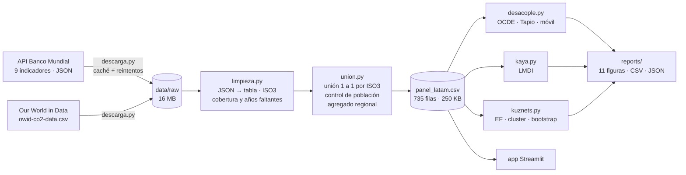
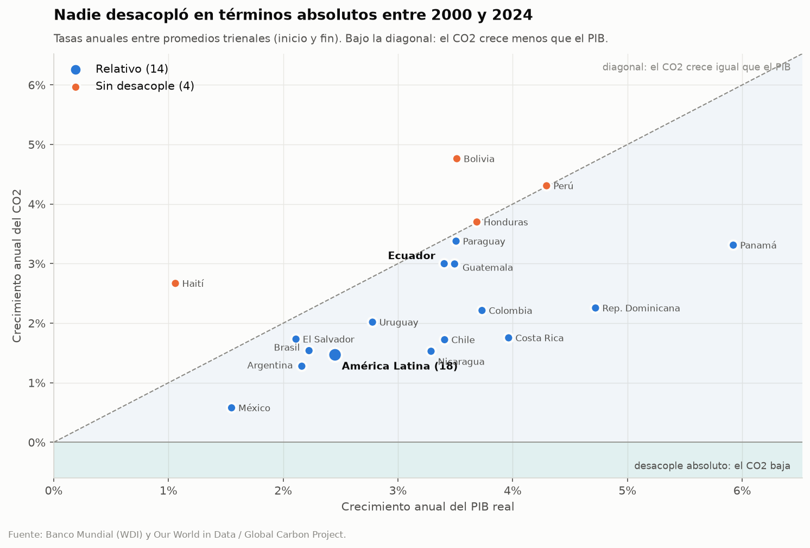
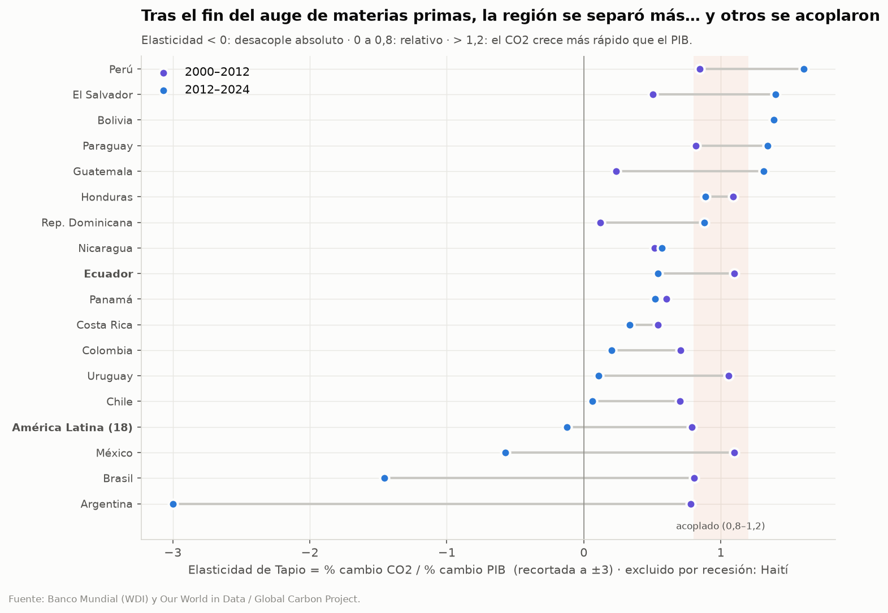
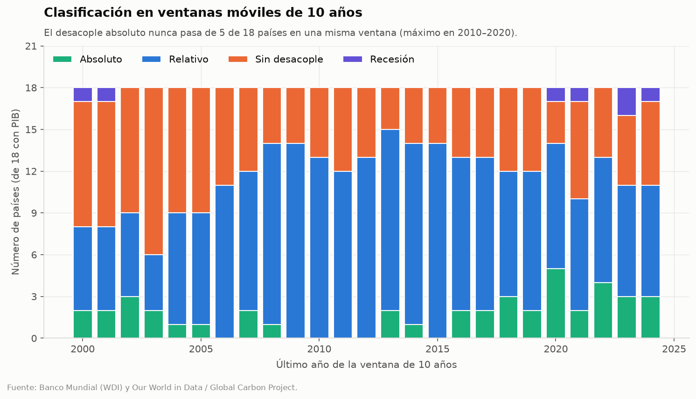
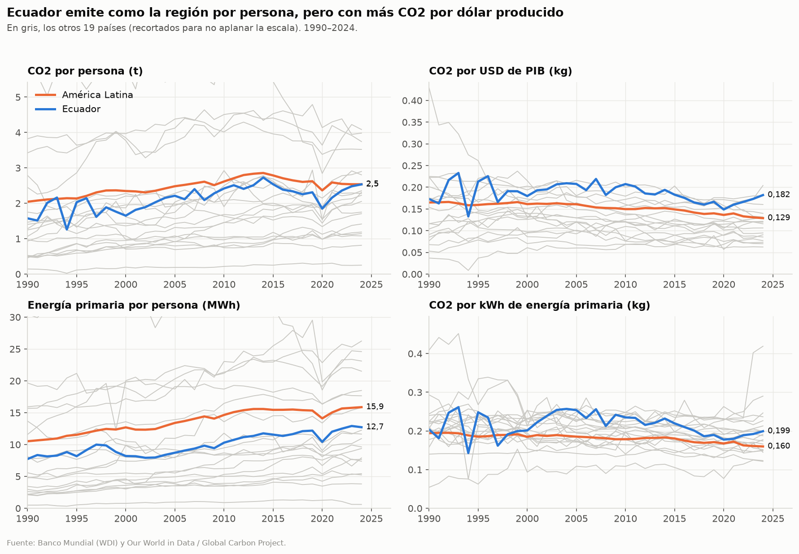
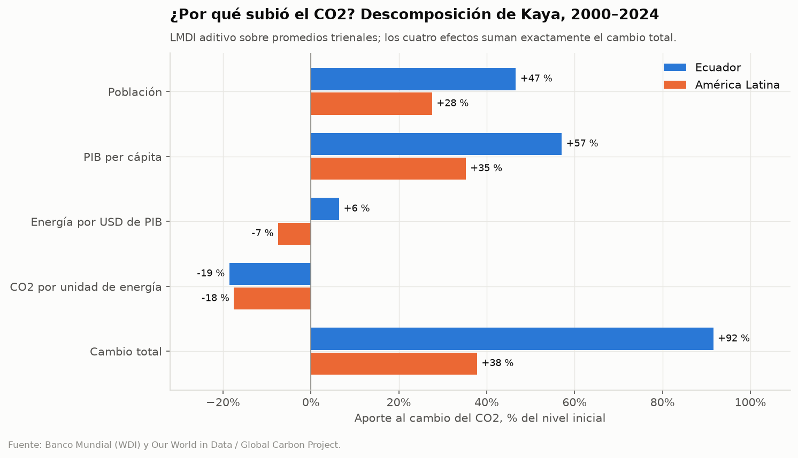
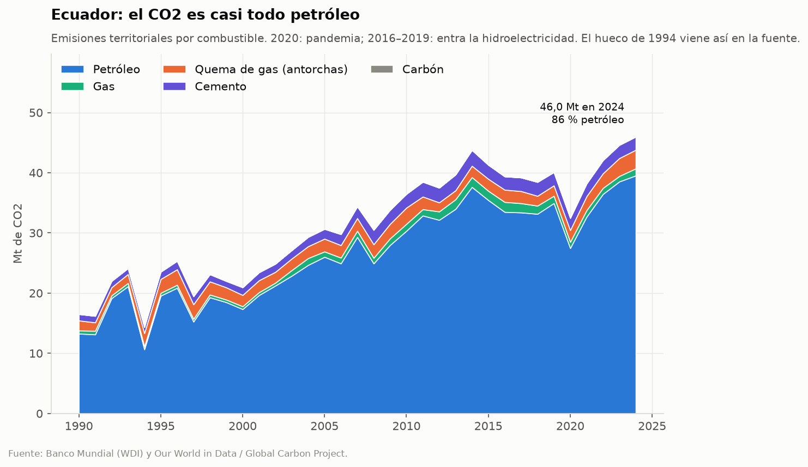
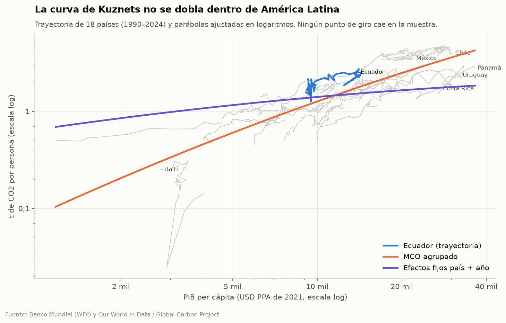
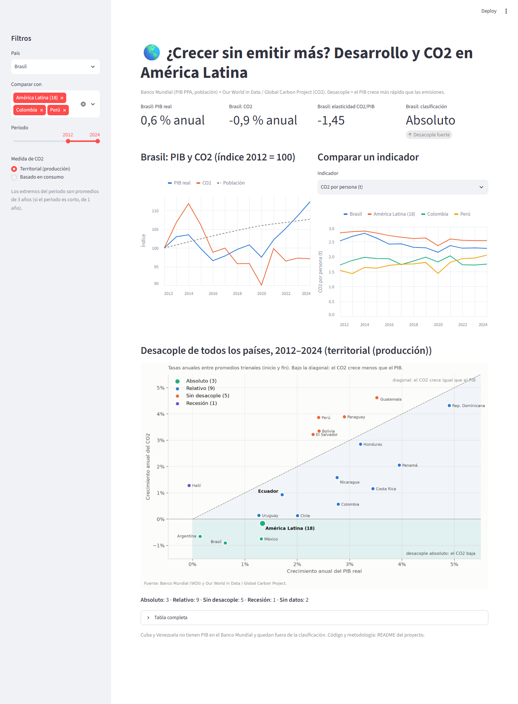
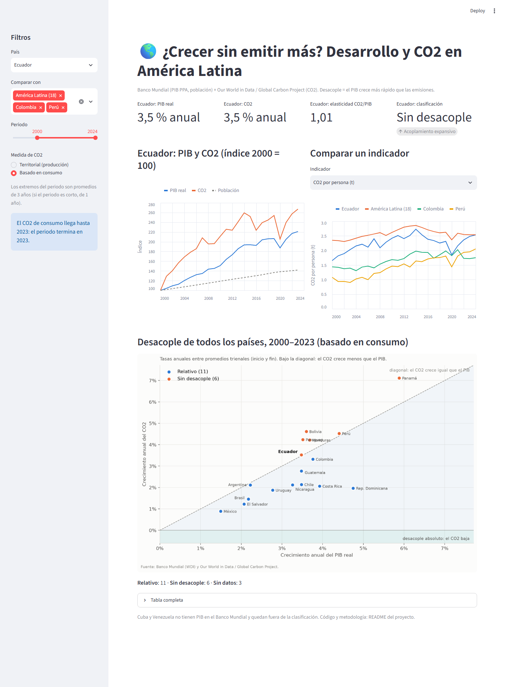

🇪🇸 **Español** · 🇬🇧 [English (summary)](README.en.md)

# 🌎 ¿Crecer sin emitir más? Desarrollo y CO2 en América Latina

¿Los países de América Latina pueden crecer sin aumentar sus emisiones? Uno las cifras del **Banco Mundial** (PIB real, población, energía, pobreza) con las de **Our World in Data / Global Carbon Project** (CO2 territorial, de consumo y por combustible) para **20 países entre 1990 y 2024** (18 con PIB en PPA completo entran al desacople, a Kaya y a Kuznets; Cuba y Venezuela solo aparecen en las emisiones). Con ese panel mido el **desacople PIB–CO2** de cada país, comparo a **Ecuador** con la región mediante una **descomposición de Kaya**, y pruebo la **curva de Kuznets ambiental**, explicando sus límites con honestidad.

-3776AB?logo=python&logoColor=white)


---

## 📌 Preguntas que responde

| # | Pregunta | Técnica | Respuesta |
|---|---|---|---|
| 1 | ¿Quién creció sin aumentar el CO2 en 2000–2024? | Tasas entre promedios trienales + clasificación OCDE y Tapio | **Nadie en términos absolutos.** 14 de 18 países desacoplaron en términos **relativos**; Bolivia, Perú, Honduras y Haití, nada |
| 2 | ¿Y después del auge de las materias primas (2012–2024)? | Subperiodos y ventanas móviles de 10 años | **Brasil, México y Argentina** bajaron su CO2 creciendo, pero muy poco (0,2 % a 1,3 % al año) |
| 3 | ¿Resiste la conclusión otra medida de CO2? | CO2 de consumo y CO2 con uso del suelo | Con CO2 de **consumo** empeora: 6 países sin desacople (Ecuador entre ellos) |
| 4 | ¿Cómo está Ecuador frente a la región? | Intensidades + Kaya con LMDI | Emite **igual por persona** (2,54 t) siendo 29 % más pobre: **41 % más CO2 por dólar** |
| 5 | ¿Por qué se duplicó el CO2 de Ecuador? | Descomposición LMDI (sin residuo) | **+92 %**: población (+47 puntos) y riqueza (+57) frente a una descarbonización de −19; la eficiencia energética **empeoró** (+6) |
| 6 | ¿Hay una curva de Kuznets en América Latina? | Panel con efectos fijos país + año, errores agrupados, bootstrap por países | **No.** β₂ nunca es significativo y el punto de giro (USD 338 mil) está 9 veces por encima del país más rico de la muestra |

## 🏗️ Arquitectura



Un comando ejecuta todo (descarga incluida): `python -m desarrollo_co2.pipeline`

## 🧹 Ingeniería de datos

| Problema real de las fuentes | Solución |
|---|---|
| Los nombres no coinciden (`Venezuela, RB` vs `Venezuela`) | Unión por **ISO 3166-1 alfa-3**, con nombres en español desde el código |
| OWID mezcla países con agregados (`World`, `South America`) | Se filtra por la lista de ISO3: los agregados no tienen código |
| La API del Banco Mundial a veces tarda o corta | `descarga.py` con caché en disco, reintentos y espera creciente |
| Filas repetidas silenciosas al unir | `merge(validate="one_to_one", indicator=True)`: **700 de 700** filas presentes en ambas fuentes |
| ¿Población del BM u OWID para los per cápita? | Control cruzado: diferencia máxima **0,0 %** (es la misma serie) |
| Cuba y Venezuela sin PIB en PPA | Se excluyen del desacople, Kaya y Kuznets; la región es la **suma de 18 países** con series completas |
| Huecos: CO2 de consumo hasta 2023 (sin Cuba ni Haití), renovables hasta 2021, pobreza con < 20 % de años en 3 países | **No se imputa**: tabla de cobertura con los años faltantes por país y variable ([figura](reports/figures/01_cobertura.png)) |
| Gas o carbón vacíos en países que no los usan | Única excepción: 0 solo si los combustibles con dato ya suman el total (±2 %) |
| Ecuador 1994: el CO2 cae a la mitad y vuelve en 1995 | Artefacto de la fuente, documentado; el análisis empieza en 2000 y usa promedios trienales |

## 📊 Resultados

### 1 · Desacople 2000–2024: relativo sí, absoluto no



| | PIB real | CO2 | Elasticidad CO2/PIB | OCDE | Tapio |
|---|---:|---:|---:|---|---|
| **América Latina (18)** | +2,45 %/año | +1,47 %/año | 0,60 | Relativo | Desacople débil |
| **Ecuador** | +3,40 %/año | +3,00 %/año | **0,88** | Relativo | **Acoplamiento** |
| México (mejor) | +1,55 %/año | +0,58 %/año | 0,37 | Relativo | Desacople débil |
| Bolivia (peor) | +3,51 %/año | +4,76 %/año | 1,36 | Sin desacople | Desacople negativo expansivo |

* Las tasas comparan **promedios trienales** (2000–02 vs 2022–24) para que un año de crisis, sequía o pandemia no decida la etiqueta.
* La regla OCDE es binaria: Paraguay (0,96), Ecuador (0,88), Guatemala y El Salvador salen como "relativo" por décimas. Con las bandas de **Tapio** (0,8–1,2 = acoplado) son **6 países acoplados**, no 2.

| Subperiodos: el desacople absoluto llega con poco crecimiento | Ventanas móviles de 10 años |
|---|---|
|  |  |

En 2012–2024 la región como agregado sí bajó su CO2 (−0,16 %/año con el PIB a +1,34 %/año), gracias a **Brasil, México y Argentina**. En cambio, Guatemala, Paraguay, Perú, Bolivia y El Salvador **se acoplaron más**. Ninguna ventana de 10 años tuvo más de 5 de 18 países en desacople absoluto.

**Robustez** (2000–2023): con **CO2 de consumo** (que cuenta las emisiones de lo que se importa) hay **6 países sin desacople** en vez de 3 (Ecuador, Honduras, Panamá y Perú pasan a esa categoría): parte del desacople territorial es CO2 que se emite en otro país. Con **CO2 de uso del suelo** aparecen 10 desacoples absolutos porque la deforestación de inicios de los 2000 era muy alta, pero esa serie es muy incierta.

### 2 · Ecuador frente a la región



| 2024 | Ecuador | América Latina (18) | Ecuador / región |
|---|---:|---:|---:|
| CO2 por persona | 2,54 t | 2,54 t | 1,00 |
| PIB per cápita (USD PPA 2021) | 13.922 | 19.683 | 0,71 |
| **CO2 por USD de PIB** | **0,182 kg** | 0,129 kg | **1,41** |
| Energía primaria por persona | 12,7 MWh | 15,9 MWh | 0,80 |
| CO2 por kWh de energía | 0,199 kg | 0,160 kg | 1,25 |
| CO2 que viene del petróleo | 86 % | 58 % | |

| Kaya: ¿por qué subió el CO2? | Ecuador: el CO2 es casi todo petróleo |
|---|---|
|  |  |

* **LMDI 2000–2024** (promedios trienales, sin residuo): en Ecuador el CO2 subió **+92 %**. Población **+47** puntos, riqueza **+57**, intensidad energética **+6** (empeoró), carbono de la energía **−19** (menos CO2 por unidad de energía; la hidroelectricidad es la explicación probable, pero no se midió aquí). En la región: +38 % = +28 +35 −7 −18.
* La diferencia con la región es que Ecuador **no ganó eficiencia energética** y quema casi solo petróleo. Entre 2014 y 2019 el CO2 bajó de 43,8 a 40,1 Mt y desde 2021 vuelve a crecer, con un récord de 46,0 Mt en 2024. Este proyecto no descompone el CO2 por fuente de electricidad, así que las causas son contexto o hipótesis, no resultados: la entrada de grandes hidroeléctricas desde 2016 (Coca Codo Sinclair, Sopladora) habría desplazado generación térmica, y en 2024 la sequía y los apagones habrían aumentado la generación térmica de respaldo.
* Medido por **consumo**, Ecuador emite un 9,6 % más de lo que emite en su territorio (2023) y su elasticidad 2000–2023 es **1,01: sin desacople**.

### 3 · Curva de Kuznets ambiental: no aparece



ln(CO2 pc) = αᵢ + δₜ + β₁·ln(PIB pc) + β₂·ln(PIB pc)² · 18 países × 35 años = 630 observaciones · errores agrupados por país

| Modelo | β₂ | p de β₂ | Punto de giro | % de observaciones sobre el giro |
|---|---:|---:|---:|---:|
| MCO agrupado | −0,066 | 0,75 | USD 23 millones | 0 % |
| Efectos fijos país | −0,008 | 0,82 | ~10²¹ USD | 0 % |
| **Efectos fijos país + año** | **−0,036** | **0,26** | **USD 337.812** | **0 %** |
| EF país + año, cúbico | — | 0,42 | — | — |
| EF país + año, CO2 de consumo | +0,002 | 0,94 | no hay U invertida | — |

* **Bootstrap por países** (999 réplicas): el 88 % da U invertida, pero el punto de giro va de **USD 8.300 a 6 × 10¹⁸** (percentiles 5–95). El signo "esperado" no basta: la curvatura es tan leve que el máximo puede estar en cualquier parte.
* Las **elasticidades por país** van de 0,06 (México) a 1,30 (Guatemala) y casi no dependen del ingreso medio (r = −0,17): una parábola regional promedia trayectorias distintas ([figura](reports/figures/11_kuznets_pendientes.png)).

> **Límites que explico en el [notebook 5](notebooks/05_curva_kuznets.ipynb):** rango de ingreso corto (USD 1.200–36.000), correlación ≠ causalidad, variables omitidas (hidroelectricidad, petróleo, subsidios), series con tendencia (riesgo de regresión espuria), forma funcional que obliga a que haya un máximo, fuga de emisiones y solo 18 grupos para los errores agrupados. **Conclusión:** las emisiones crecen con el ingreso cada vez menos que proporcionalmente, pero no hay evidencia de que vayan a bajar solas al hacerse más ricos los países.

## 🖥️ App interactiva

`streamlit run app/streamlit_app.py`: elige país, países de comparación, periodo y medida de CO2 (territorial o consumo). Calcula al vuelo las tasas, la elasticidad, la clasificación OCDE y Tapio de todos los países, y acepta enlaces del tipo `?pais=Brasil&desde=2012&hasta=2024&medida=consumo`.

| Ecuador 2000–2024 | Brasil 2012–2024 | Ecuador con CO2 de consumo |
|---|---|---|
|  |  |  |

## 📓 Notebooks (ejecutados, con resultados)

1. [Ingesta, unión y calidad](notebooks/01_ingesta_y_calidad.ipynb): caché, ISO3, unión 1 a 1, cobertura y años faltantes
2. [Análisis exploratorio](notebooks/02_analisis_exploratorio.ipynb): emisiones vs ingreso, la región en el tiempo, combustibles, consumo y uso del suelo
3. [Desacople PIB–CO2](notebooks/03_desacople_pib_co2.ipynb): clasificación OCDE y Tapio, subperiodos, ventanas móviles, robustez
4. [Ecuador frente a la región](notebooks/04_ecuador_vs_region.ipynb): intensidades, fuentes del CO2, Kaya con LMDI
5. [Curva de Kuznets ambiental](notebooks/05_curva_kuznets.ipynb): 5 especificaciones, bootstrap, heterogeneidad y límites

## 🧠 Decisiones técnicas

* **PIB en PPA a precios constantes de 2021** (no en dólares corrientes): compara volumen real de producción entre países y años, sin el ruido del tipo de cambio ni de la inflación.
* **CO2 fósil + industria (territorial)** como medida principal: es la serie más completa y precisa. Consumo y uso del suelo se usan como robustez, no se mezclan.
* **Promedios trienales en los extremos**: un solo año (2020, una sequía, una crisis) puede invertir la etiqueta de un país.
* **Dos clasificaciones (OCDE y Tapio)**: la binaria es la habitual en informes; Tapio evita llamar "desacople" a una elasticidad de 0,96.
* **Región = suma, no promedio**: un promedio de tasas daría el mismo peso a Haití y a Brasil. Si falta un miembro en un año, el total queda vacío.
* **LMDI aditivo** para Kaya: reparte el cambio sin residuo (hay una prueba que lo verifica).
* **Errores agrupados por país + bootstrap por países** en Kuznets: con 35 años de cada país, los errores clásicos exageran la precisión.

## 🚀 Cómo ejecutarlo

Guía detallada para Windows, con preguntas de entrevista: **[docs/GUIA_PASO_A_PASO.md](docs/GUIA_PASO_A_PASO.md)**

```bash
python -m venv .venv && .venv\Scripts\activate
pip install -r requirements.txt
pip install -e .
python descargar_datos.py             # baja los datos a data/raw (caché; --forzar para renovar)
python -m desarrollo_co2.pipeline     # panel, análisis, figuras y reports/resultados.json (~1 min)
pytest                                # 43 pruebas
streamlit run app/streamlit_app.py    # funciona con el panel versionado, sin descargar nada
```

## 📁 Estructura

```
├── descargar_datos.py        descarga desde las fuentes oficiales a data/raw (caché)
├── src/desarrollo_co2/
│   ├── config.py             países (ISO3), indicadores, periodos, paleta
│   ├── descarga.py           API del Banco Mundial y CSV de OWID con caché y reintentos
│   ├── limpieza.py           JSON → tabla, filtros, cobertura y años faltantes
│   ├── union.py              unión por ISO3, controles, variables derivadas, agregado regional
│   ├── desacople.py          tasas, clasificación OCDE y Tapio, ventanas móviles, robustez
│   ├── kaya.py               descomposición LMDI
│   ├── kuznets.py            panel con efectos fijos, errores agrupados, bootstrap, pendientes por país
│   ├── graficos.py           11 figuras con estilo consistente
│   └── pipeline.py           orquestador (un comando)
├── notebooks/                5 notebooks ejecutados
├── app/                      app Streamlit
├── tests/                    43 pruebas (pytest), incluidas pruebas de humo de la app
├── data/procesados/          panel_latam.csv y cobertura.csv (versionados)
└── reports/                  figuras, capturas de la app, CSV y resultados.json
```

## 📚 Fuentes y licencias

* **Banco Mundial — World Development Indicators**, vía [API v2](https://datahelpdesk.worldbank.org/knowledgebase/articles/889392) (`https://api.worldbank.org/v2/`). Licencia [CC BY 4.0](https://datacatalog.worldbank.org/public-licenses#cc-by). Indicadores: `NY.GDP.MKTP.PP.KD`, `NY.GDP.PCAP.PP.KD`, `SP.POP.TOTL`, `SP.URB.TOTL.IN.ZS`, `NV.IND.TOTL.ZS`, `EG.FEC.RNEW.ZS`, `EG.ELC.ACCS.ZS`, `SI.POV.DDAY`, `AG.LND.FRST.ZS`.
* **Our World in Data — CO2 and Greenhouse Gas Emissions** ([repositorio](https://github.com/owid/co2-data), datos del Global Carbon Project y otras fuentes). Licencia [CC BY 4.0](https://creativecommons.org/licenses/by/4.0/).

Datos descargados en octubre de 2026; con otra descarga las cifras pueden cambiar ligeramente por revisiones de las fuentes.

**Licencia:** el **código** de este repositorio es [MIT](LICENSE) (© 2026 Erick Guarnizo); los **datos** siguen la licencia propia de cada fuente, la citada arriba (CC BY 4.0).

## 👤 Autor

**Erick Guarnizo** · Ingeniero en Sistemas · [LinkedIn](https://www.linkedin.com/in/erick-g-571a7b3b4)
