<!-- Archivo generado por `python -m empleo_enemdu.cifras_readme` desde scripts/plantillas/README.md.
     No lo edites a mano: cambia la plantilla y vuelve a generarlo. Todas las cifras salen de reports/. -->
🇪🇸 **Español** · 🇬🇧 [English (summary)](README.en.md)

# Mercado laboral del Ecuador con encuesta ponderada · microdatos INEC ENEMDU 2025 (validados con 2024) y serie oficial 2018–2025


Análisis del mercado laboral ecuatoriano con los microdatos de la **Encuesta Nacional de Empleo, Desempleo y Subempleo (ENEMDU anual 2025)** del **Instituto Nacional de Estadística y Censos (INEC)**, respetando su diseño muestral complejo.

El proyecto implementa desde cero la **linealización de Taylor** para un diseño estratificado por conglomerados (`estrato = plan_muestreo`, `upm = id_sector`, factor de expansión `fexp`). Con ese motor, las **80 celdas** del tabulado oficial (`10 indicadores × 8 dominios`) **coinciden con lo publicado por el INEC dentro del redondeo a un decimal**, tanto en la estimación como en el error estándar (diferencia máxima tras redondear: `0,0 pp`). Sobre esa base se estiman ecuaciones de **Mincer** con errores agrupados por UPM, una descomposición de **Kitagawa-Oaxaca-Blinder** con *bootstrap* por conglomerados, brechas por cuantiles ($P_{10} \dots P_{90}$), **curvas de Lorenz** ponderadas (Gini = `0,451`, igual al `0,451` publicado) y un contrafactual de pobreza.

> **Qué es cálculo propio y qué no.** Las cifras de 2025 se calculan con microdatos. La **serie 2018–2025** de la figura 02 es la **publicada por el INEC** en sus tabulados (no hay año 2020). Para comprobar que el motor también reproduce otros años, se recalcularon los **microdatos 2024**: 80/80 celdas coinciden con la serie oficial (sección 2.3).

---

## 1. Fuente de datos y licencia

| Elemento | Detalle |
| :--- | :--- |
| Publicador | Instituto Nacional de Estadística y Censos (INEC), Ecuador · [ecuadorencifras.gob.ec](https://www.ecuadorencifras.gob.ec/) |
| Encuesta | ENEMDU anual 2025 (microdatos de personas y vivienda, tabulados, diccionario y sintaxis SPSS) y microdatos ENEMDU anual 2024 (solo para validar) |
| Descarga | 2025: 21-10-2026 · 2024: 25-10-2026 (URL, tamaño y SHA-256 de cada archivo en [`docs/fuentes.md`](docs/fuentes.md)) |
| Términos de uso | Datos de acceso público y gratuito. Este repositorio **no redistribuye los microdatos completos** (`data/raw/` está en `.gitignore`); se descargan del INEC con `python descargar_datos.py`, que usa TLS verificado y comprueba el SHA-256 de cada archivo contra [`docs/fuentes.md`](docs/fuentes.md) (aborta si no coincide). Al reutilizar las cifras, cita: *INEC, Encuesta Nacional de Empleo, Desempleo y Subempleo (ENEMDU) anual 2025*. Detalle en [`docs/fuentes.md`](docs/fuentes.md). |

| Muestra versionada | [`data/muestra/muestra_enemdu_2025.parquet`](data/muestra) (180 KB) es una **submuestra de microdatos públicos** del INEC: 120 UPM completas (5.552 personas) de la ENEMDU 2025 ya limpiadas, sin nombres ni direcciones. Solo sirve para que las pruebas corran sin red. **La licencia de redistribución de las bases del INEC no está confirmada**: si prefieres no publicarla, borra la carpeta `data/muestra/` y las pruebas que la usan se omiten. |
| Licencia | El **código** es [MIT](LICENSE) (© 2026 Erick Guarnizo). Los **datos** siguen los términos del INEC (sin confirmar, ver [`docs/fuentes.md`](docs/fuentes.md)). Las cifras son cálculo propio y no son estadísticas oficiales. |

---

## 2. Hallazgos principales (ENEMDU anual 2025)

### 2.1 Calidad de datos: los códigos centinela
La base tiene `334.786` registros de personas (`104.738` hogares) que se expanden a `18.855.042` habitantes (`PET = 13.400.117`; `PEA = 8.612.073`; `Ocupados = 8.304.522`). El ingreso laboral (`ingrl`) usa **`999999`** para quien no informa (`480` casos) y **`-1`** para quien no tiene ingreso monetario (`1.471` casos).
* Promediar `ingrl` sin limpiar esos códigos da **`3.840,42 USD/mes`**, frente a la media ponderada correcta de **`498,97 USD/mes`** (**`7,7` veces** más).

### 2.2 Coincidencia con el tabulado oficial del INEC (80/80 celdas)
La ENEMDU no es un muestreo aleatorio simple (MAS): tiene **`150` estratos** y **`7.780` unidades primarias de muestreo (UPM)**. Ignorar `fexp` sesga las tasas (la muestra tiene proporcionalmente menos PEA rural que la población) e ignorar los conglomerados subestima los errores estándar: el `DEFT = √DEFF` va de **2,84x** a **6,68x**.

| Indicador nacional (ENEMDU 2025) | Calculado (%) | Oficial INEC (%) | Dif. (pp, a 1 decimal) | Sin ponderar (%) | Sesgo sin `fexp` (pp) | EE complejo (%) | EE oficial (%) | EE MAS ingenuo (%) | `DEFT` | `DEFF` | IC 95 % complejo |
| :--- | :---: | :---: | :---: | :---: | :---: | :---: | :---: | :---: | :---: | :---: | :---: |
| **Empleo Adecuado/Pleno** | **37,1** | **37,1** | `0,0` | 41,7 | `+4,6` | 0,59 | 0,6 | 0,12 | **5,04x** | 25,36 | `[36,0; 38,3]` |
| **Subempleo** | **19,4** | **19,4** | `0,0` | 17,1 | `-2,3` | 0,36 | 0,4 | 0,10 | **3,73x** | 13,89 | `[18,7; 20,1]` |
| **Otro Empleo no pleno** | **30,8** | **30,8** | `0,0` | 28,4 | `-2,4` | 0,49 | 0,5 | 0,11 | **4,35x** | 18,96 | `[29,9; 31,8]` |
| **Empleo no Remunerado** | **8,8** | **8,8** | `0,0` | 8,0 | `-0,8` | 0,46 | 0,5 | 0,07 | **6,68x** | 44,68 | `[7,9; 9,7]` |
| **Desempleo** | **3,6** | **3,6** | `0,0` | 4,4 | `+0,9` | 0,13 | 0,1 | 0,05 | **2,84x** | 8,07 | `[3,3; 3,8]` |
| **Sector informal (% ocupados)** | **51,5** | **51,5** | `0,0` | 43,7 | `-7,8` | 0,81 | 0,8 | 0,12 | **6,48x** | 42,03 | `[49,9; 53,1]` |
| **Empleo Bruto (% PET)** | **62,0** | **62,0** | `0,0` | 60,7 | `-1,3` | 0,44 | 0,4 | 0,09 | **4,70x** | 22,11 | `[61,1; 62,8]` |
| **Participación Global (% PET)** | **64,3** | **64,3** | `0,0` | 63,5 | `-0,8` | 0,46 | 0,5 | 0,09 | **4,93x** | 24,33 | `[63,4; 65,2]` |

*«Dif.» compara ambas cifras redondeadas a un decimal, que es la precisión con la que publica el INEC; no es una diferencia exacta de cero.*

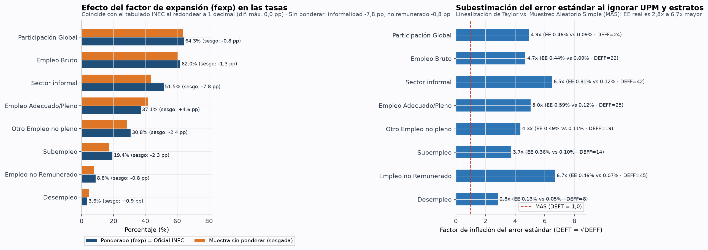

### 2.3 Serie oficial 2018–2025, validación 2024 y brecha territorial
* **Serie publicada por el INEC:** el desempleo de 2025 es **3,6 %**, pero la **informalidad alcanza al 51,5 % de los ocupados** (`+4,7 pp` frente al `46,8 %` de 2018; el máximo de la serie fue `52,5 %` en 2023).
* **Validación con microdatos 2024:** con la misma limpieza y el mismo motor (341.394 personas, 4.973 UPM), 80 de 80 celdas coinciden con la serie oficial al redondear a un decimal (por ejemplo, informalidad `52,37 %` frente a `52,4 %` publicado; empleo adecuado `35,88 %` frente a `35,9 %`). Detalle en `reports/tablas/validacion_microdatos_2024.csv`.
* **Área:** en el área **rural** el **71,5 %** de los ocupados está en el sector informal y solo el **21,9 %** de la PEA tiene empleo adecuado, frente a **40,4 %** y **45,3 %** en el área **urbana**.
* **Provincias:** la informalidad va de **16,21 % en Galápagos** y **28,43 % en Pichincha** hasta **77,20 % en Bolívar**, **81,54 % en Napo** y **87,35 % en Morona Santiago**. Las tasas provinciales coinciden con la serie oficial 2025 con una diferencia máxima de `0,1 pp` (redondeo).

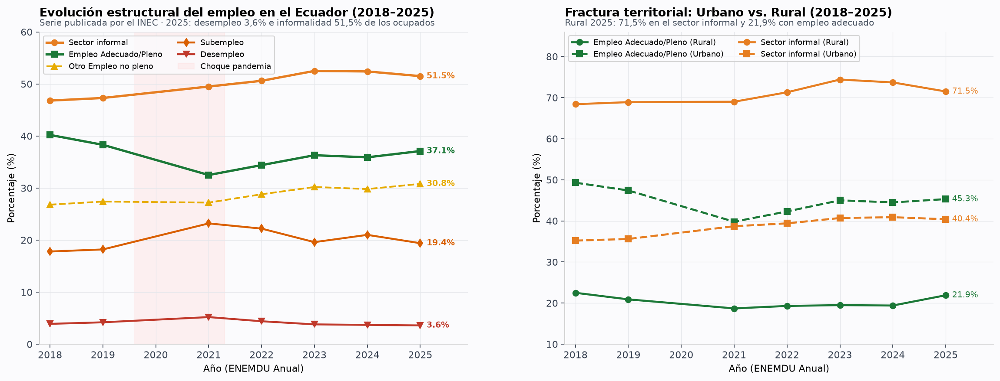

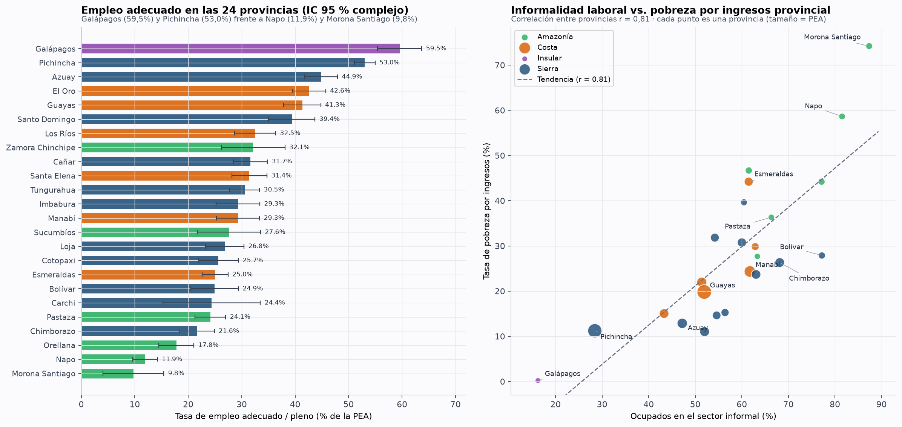

### 2.4 Jóvenes, etnia, género y ramas de actividad
* **Desempleo juvenil (15–24 años):** **9,07 %**, unas **2,5 veces** la tasa nacional (3,6 %). Solo el 21,8 % de la PEA joven tiene empleo adecuado y el 20,4 % trabaja sin remuneración (`n = 22.654` jóvenes en la PEA).
* **Autoidentificación étnica:** la población **indígena** tiene **76,91 %** de informalidad y **18,15 %** de empleo adecuado (ingreso medio `349,78 USD`), frente a **46,47 %** y **40,92 %** en la población **mestiza** (`524,32 USD`).
* **Brecha de género en empleo adecuado:** **42,43 %** de los hombres de la PEA frente a **29,96 %** de las mujeres (`diferencia = +12,47 pp`, IC 95 % `[10,91; 14,03]`, `t = 15,68`, `p ≈ 1,5 × 10⁻⁵⁴`). Como hombres y mujeres comparten hogares y sectores censales, la covarianza intra-UPM es positiva y el error estándar de la diferencia (`0,80 pp`) es menor que el que supondría independencia (`1,01 pp`).
* **Ramas CIIU:** la informalidad es **81,92 % en agricultura, ganadería y pesca** (31,1 % del empleo; mediana `240 USD/mes`) y **76,27 % en construcción**, frente a **5,79 % en enseñanza** (mediana `875 USD/mes`) y **0,06 % en administración pública** (mediana `1.032 USD/mes`).

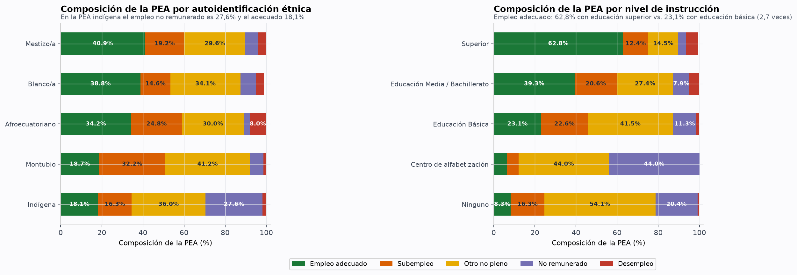

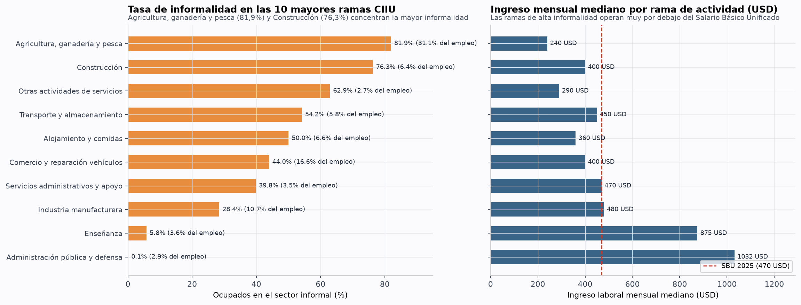

### 2.5 Salario Básico Unificado (`470 USD`) y ecuación de Mincer
* En el **sector informal**, el **83,9 %** de los ocupados con ingreso gana menos del SBU (mediana ponderada **`235 USD/mes`**). En el **sector formal** la distribución se concentra en el SBU (*efecto faro*): mediana **`555 USD/mes`** y 24,3 % por debajo del SBU.

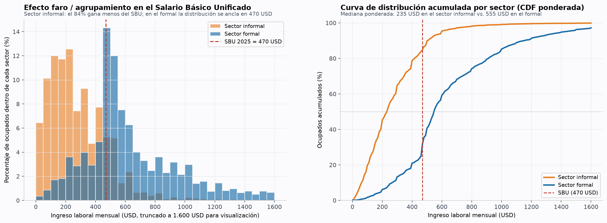

* **Ecuación de Mincer** (`n = 138.381` ocupados con salario por hora positivo en `7.780` UPM). La tabla se genera desde `reports/resultados.json`:

| Especificación (WLS con `fexp`, EE agrupados por UPM) | n | $\hat{\beta}_{\text{esc}}$ | Retorno por año | $\text{EE}_{\text{cluster}}$ | $\text{EE}_{\text{WLS}}$ | Razón EE | $R^2$ ponderado | Lectura |
| :--- | :---: | :---: | :---: | :---: | :---: | :---: | :---: | :--- |
| **M1. Mincer clásico (escolaridad + exp + mujer + rural)** | 138.381 | `0,07085` | **+7,34 %** | `0,00167` | `0,00048` | 3,51x | `0,2129` | Retorno bruto de un año de escolaridad |
| **M2. + Formalidad y afiliación IESS** | 138.381 | `0,04226` | **+4,32 %** | `0,00133` | `0,00047` | 2,86x | `0,3510` | Informal -31,83 % · afiliado IESS +35,33 % |
| **M3. + Etnia, EF Rama (21) y EF Provincia (24)** | 138.381 | `0,03143` | **+3,19 %** | `0,00136` | `0,00050` | 2,72x | `0,3932` | Retorno dentro de la misma provincia y rama económica |
| **M4. Submuestra Sector Formal** | 77.133 | `0,07385` | **+7,66 %** | `0,00189` | `0,00055` | 3,45x | `0,2198` | Retorno dentro del sector formal |
| **M5. Submuestra Sector Informal** | 53.941 | `0,02142` | **+2,17 %** | `0,00214` | `0,00084` | 2,53x | `0,0732` | La escolaridad se remunera poco en la informalidad |

* Al controlar formalidad y afiliación al IESS (M2), el retorno por año de escolaridad baja de 7,34 % a 4,32 %: alrededor del **40 %** del retorno bruto se asocia al acceso a empleo formal.
* **Efecto diploma** (neto de formalidad, frente a sin instrucción): Básica **+5,57 %** (no significativo al 95 %), Bachillerato **+16,80 %**, Superior técnica **+46,47 %**, Superior universitaria **+59,98 %** y Posgrado **+158,05 %**.

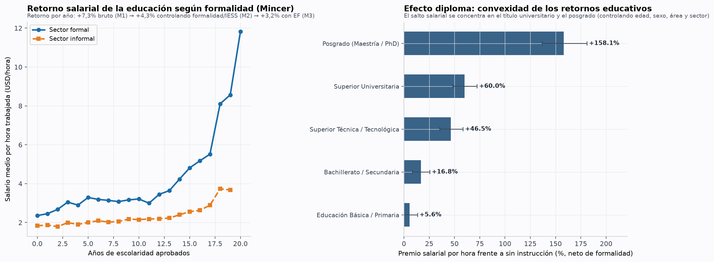

### 2.6 Oaxaca-Blinder y brecha por cuantiles
* Los hombres ganan en promedio **`533,45 USD/mes`** y las mujeres **`462,67 USD/mes`** (brecha mensual de **`13,27 %`**), en parte porque trabajan **`38,2`** frente a **`33,3` horas remuneradas por semana**.
* En **logaritmo del salario por hora** la brecha es **`0,0930` puntos log (`9,75 %`)**. Descomposición de Kitagawa-Oaxaca-Blinder (coeficientes agrupados de Neumark, IC percentílico de un *bootstrap* de 120 réplicas por UPM):
  * **Dotaciones (parte explicada): `-0,0775`** (`-7,45 %`, IC 95 % `[-0,1040; -0,0563]`). Es **negativa** porque las mujeres ocupadas tienen **más escolaridad (`10,93` frente a `9,97` años; aporte `-2,94 pp`)** y más formalidad entre quienes perciben salario (`-2,74 pp`).
  * **Estructura o retornos (no explicada): `+0,1705`** (`+18,59 %`, IC 95 % `[0,1538; 0,1883]`). Con iguales características observables, la brecha ajustada supera a la bruta.
* **Cuantiles:** en el **sector informal** la brecha por hora es **35,5 % en $P_{10}$** y **30,6 % en $P_{25}$** (*piso pegajoso*). En el **sector formal** baja de 11,9 % en $P_{10}$ a **0,0 % en $P_{30}$** y **0,6 % en $P_{50}$**, donde el SBU actúa como piso.

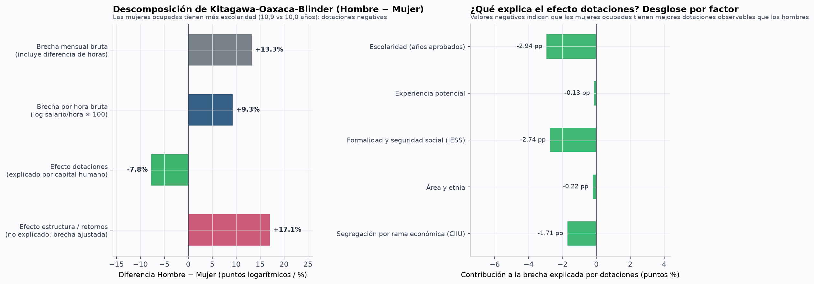

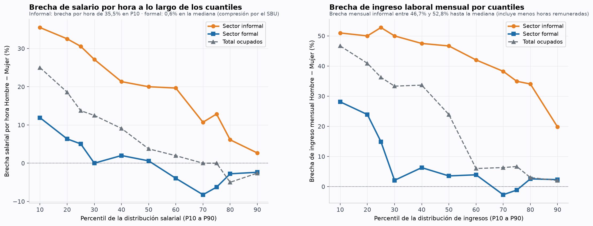

### 2.7 Desigualdad y pobreza
* **Gini del ingreso per cápita del hogar: `0,451`** (el tabulado de Pobreza 2025 del INEC publica `0,451`); **índice de Palma `2,43`**: el 10 % más rico concentra el **`34,36 %`** del ingreso y el 40 % más pobre el **`14,12 %`**. La pobreza por ingresos calculada es `21,78 %` (oficial: `21,8 %`).
* La pobreza dentro de la PEA es **`0,95 %`** con **empleo adecuado**, **`26,43 %`** en **subempleo**, **`25,79 %`** en **desempleo**, **`26,64 %`** en el **sector informal** y **`38,50 %`** en **empleo no remunerado**.
* **Contrafactual estático:** si en cada hogar el ocupado informal con mayor brecha llegara al SBU, la pobreza pasaría de `21,78 %` a `9,79 %` (`-11,98 pp`). Es una cota superior aritmética (ver limitaciones).

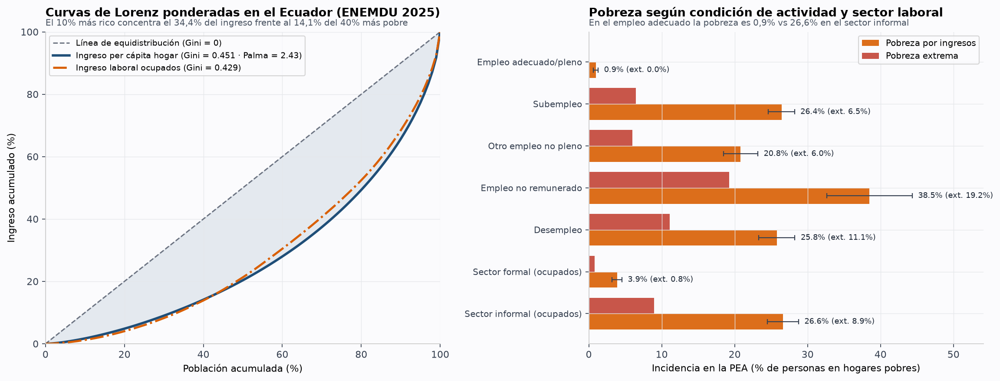

---

## 3. Decisiones técnicas

1. **Motor de varianza propio (numpy) en lugar de una librería de encuestas.** Así cada paso de la linealización de Taylor es visible y se comprueba celda a celda contra el tabulado oficial; con `numpy.bincount` las 80 celdas se calculan en segundos.
2. **Dominios sin filtrar filas.** Para subpoblaciones (mujeres, jóvenes, provincias) se usa una indicadora de dominio y se conservan todas las UPM; filtrar antes cambiaría el número de UPM por estrato y la varianza.
3. **Variables laborales replicadas de la sintaxis SPSS oficial** (`00 Indicadores de Mercado Laboral.sps`): condición de actividad, empleo adecuado, subempleo, sector informal. Es lo que permite coincidir con el INEC.
4. **Códigos centinela a faltante, no a cero.** `999999` y `-1` en `ingrl` se excluyen de los promedios de ingreso; los estadísticos de ingreso usan solo ingresos positivos.
5. **Mincer con WLS y errores agrupados por UPM** (`statsmodels`, `cov_type="cluster"`). No incorpora la estratificación en la varianza (es algo conservador) y se reporta la razón frente al error ingenuo.
6. **Oaxaca-Blinder con coeficientes agrupados (Neumark)** y *bootstrap* que remuestrea UPM completas (120 réplicas, semilla 42) para intervalos que respetan los conglomerados.
7. **Serie histórica tomada del tabulado oficial**, no recalculada; la validación con microdatos 2024 (`python -m empleo_enemdu.validacion_anual --anio 2024`) muestra que el mismo motor reproduce otro año.
8. **README y guía generados desde plantillas** (`python -m empleo_enemdu.cifras_readme`), con una prueba que falla si el texto se desfasa de `reports/`.
9. **Microdatos procesados fuera de Git.** `data/procesados/enemdu_pet_2025.parquet` (unos 6 MB, persona a persona) se ignora; se versionan los agregados (`reports/`, serie y estimadores oficiales) y una muestra de 120 UPM (`data/muestra/`) para las pruebas.
10. **Figuras PNG a 160 DPI**, con subtítulos construidos desde los datos.

---

## 4. Limitaciones

1. **No respuesta y medición del ingreso.** Se excluyen `480` ocupados que no informan su ingreso; si quienes no responden ganan sistemáticamente más (o menos), las medias, medianas y brechas salariales quedan sesgadas. El factor `fexp` está pensado para la selección de viviendas y la calibración poblacional, no para la no respuesta a la pregunta de ingreso. Además el ingreso es autodeclarado y los ingresos altos suelen subdeclararse, lo que probablemente subestima el Gini.
2. **Selección y endogeneidad en Mincer.** Solo se observan salarios de quienes trabajan con ingreso positivo (`n = 138.381`); la participación no es aleatoria (sobre todo en mujeres rurales) y la escolaridad se correlaciona con habilidad no observada. Los coeficientes son asociaciones condicionales, no efectos causales.
3. **Dominios pequeños.** Algunas provincias tienen pocas observaciones en la PEA y errores estándar amplios (ver `informalidad_ee_pct` en `reports/tablas/indicadores_provincias_2025.csv`); conviene leer sus IC y no solo la estimación puntual.
4. **Corte transversal.** La base anual no sigue a las mismas personas en el tiempo; no permite estudiar transiciones entre empleo e informalidad.
5. **Serie sin 2020 y con un solo año extra validado.** La serie oficial no incluye 2020; solo 2024 se recalculó con microdatos.
6. **Contrafactual del SBU.** Mantiene el empleo constante (elasticidad cero). Con `51,5 %` de informalidad, subir salarios por decreto sin productividad podría trasladar empleo al desempleo o al autoempleo.
7. **IC de Oaxaca con 120 réplicas.** Suficientes para un orden de magnitud; los extremos del intervalo percentílico pueden moverse en el tercer decimal con otra semilla.

---

## 5. Arquitectura y estructura del proyecto

### Arquitectura

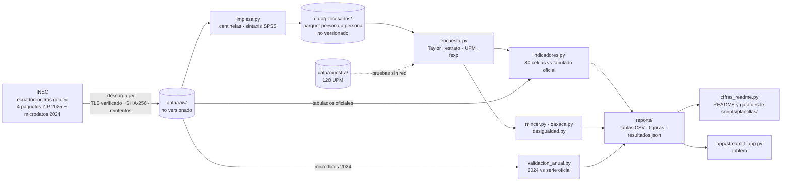

```text
mercado-laboral-ecuador-enemdu/
├── descargar_datos.py                  # Descarga idempotente de los 4 paquetes oficiales INEC 2025 y manifiesto
├── pyproject.toml / requirements.txt   # Paquete, pytest y versiones fijadas
├── data/
│   ├── raw/                            # Microdatos, tabulados y sintaxis del INEC (ignorado por Git)
│   ├── procesados/                     # Serie oficial 2018-2025 y estimadores oficiales (el parquet de microdatos se ignora)
│   └── muestra/                        # Muestra de 120 UPM de los microdatos públicos del INEC, para pruebas sin red (ver sección 1)
├── src/empleo_enemdu/
│   ├── config.py                       # Rutas, URLs del INEC, catálogos DPA, CIIU y CIUO
│   ├── descarga.py                     # Descarga con TLS verificado, SHA-256 obligatorio, reintentos y extracción ZIP
│   ├── limpieza.py                     # Centinelas y réplica de la sintaxis SPSS del INEC
│   ├── encuesta.py                     # Linealización de Taylor, DEFF/DEFT, covarianza intra-UPM
│   ├── indicadores.py                  # Reconciliación con el INEC, provincias, subgrupos, ramas e ingresos por sector
│   ├── mincer.py / oaxaca.py           # Econometría laboral
│   ├── desigualdad.py                  # Lorenz, Gini, Palma, pobreza y contrafactual
│   ├── graficos.py                     # 10 figuras con subtítulos generados desde los datos
│   ├── validacion_anual.py             # Recalcula 2024 con microdatos y lo compara con la serie oficial
│   ├── cifras_readme.py                # Genera README y guía desde scripts/plantillas/ y reports/
│   └── pipeline.py                     # Orquestador (~47 s)
├── notebooks/01..05_*.ipynb            # Ejecutados, con sus figuras
├── app/streamlit_app.py                # Tablero interactivo
├── reports/                            # resultados.json, validacion_microdatos_2024.json, tablas/*.csv, figures/*.png
├── scripts/plantillas/                 # Plantillas del README y la guía (las usa cifras_readme.py)
├── tests/                              # Pruebas (Taylor, 80 celdas, econometría, descarga segura, app, cifras del README)
└── docs/
    ├── GUIA_PASO_A_PASO.md             # Guía técnica y preguntas de entrevista (generada)
    └── fuentes.md                      # URLs, fechas, SHA-256 y términos de uso
```

---

## 6. Reproducción

```powershell
# 1. Entorno (Python 3.14)
py -3.14 -m venv .venv
.\.venv\Scripts\Activate.ps1
pip install -r requirements.txt
pip install -e .

# 2. Descargar los paquetes oficiales del INEC (data/raw/, ~14 MB). Usa TLS verificado y aborta si el SHA-256 no coincide.
#    Si el certificado del INEC no se valida en tu equipo: python descargar_datos.py --certificados certifi
python descargar_datos.py

# 3. Pipeline completo: parquet, tablas, figuras y reports/resultados.json (~47 s)
python -m empleo_enemdu.pipeline --sin-descarga

# 4. Validación con microdatos 2024 (descarga ~14 MB más)
python -m empleo_enemdu.validacion_anual --anio 2024

# 5. Regenerar README y guía con las cifras actuales
python -m empleo_enemdu.cifras_readme

# 6. Notebooks y pruebas
jupyter nbconvert --to notebook --execute --inplace notebooks/*.ipynb
pytest -v

# 7. Tablero
streamlit run app/streamlit_app.py
```
