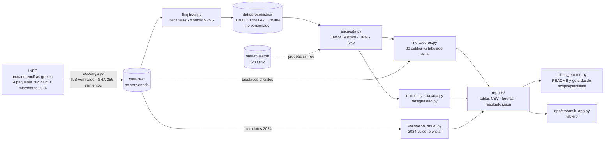

<!-- Archivo generado por `python -m empleo_enemdu.cifras_readme` desde scripts/plantillas/README.md.
     No lo edites a mano: cambia la plantilla y vuelve a generarlo. Todas las cifras salen de reports/. -->
# Mercado laboral del Ecuador con encuesta ponderada · microdatos INEC ENEMDU 2025 (validados con 2024) y serie oficial {{serie_anio_ini}}–{{serie_anio_fin}}


Análisis del mercado laboral ecuatoriano con los microdatos de la **Encuesta Nacional de Empleo, Desempleo y Subempleo (ENEMDU anual 2025)** del **Instituto Nacional de Estadística y Censos (INEC)**, respetando su diseño muestral complejo.

El proyecto implementa desde cero la **linealización de Taylor** para un diseño estratificado por conglomerados (`estrato = plan_muestreo`, `upm = id_sector`, factor de expansión `fexp`). Con ese motor, las **{{celdas_total}} celdas** del tabulado oficial (`10 indicadores × 8 dominios`) **coinciden con lo publicado por el INEC dentro del redondeo a un decimal**, tanto en la estimación como en el error estándar (diferencia máxima tras redondear: `{{dif_max_ind}} pp`). Sobre esa base se estiman ecuaciones de **Mincer** con errores agrupados por UPM, una descomposición de **Kitagawa-Oaxaca-Blinder** con *bootstrap* por conglomerados, brechas por cuantiles ($P_{10} \dots P_{90}$), **curvas de Lorenz** ponderadas (Gini = `{{gini}}`, igual al `{{gini_oficial}}` publicado) y un contrafactual de pobreza.

> **Qué es cálculo propio y qué no.** Las cifras de 2025 se calculan con microdatos. La **serie {{serie_anio_ini}}–{{serie_anio_fin}}** de la figura 02 es la **publicada por el INEC** en sus tabulados (no hay año {{serie_anios_faltan}}). Para comprobar que el motor también reproduce otros años, se recalcularon los **microdatos 2024**: {{v24_ok}}/{{v24_total}} celdas coinciden con la serie oficial (sección 2.3).

---

## 1. Fuente de datos y licencia

| Elemento | Detalle |
| :--- | :--- |
| Publicador | Instituto Nacional de Estadística y Censos (INEC), Ecuador · [ecuadorencifras.gob.ec](https://www.ecuadorencifras.gob.ec/) |
| Encuesta | ENEMDU anual 2025 (microdatos de personas y vivienda, tabulados, diccionario y sintaxis SPSS) y microdatos ENEMDU anual 2024 (solo para validar) |
| Descarga | 2025: 21-10-2026 · 2024: 25-10-2026 (URL, tamaño y SHA-256 de cada archivo en [`docs/fuentes.md`](docs/fuentes.md)) |
| Términos de uso | Datos de acceso público y gratuito. Este repositorio **no redistribuye los microdatos completos** (`data/raw/` está en `.gitignore`); se descargan del INEC con `python descargar_datos.py`, que usa TLS verificado y comprueba el SHA-256 de cada archivo contra [`docs/fuentes.md`](docs/fuentes.md) (aborta si no coincide). Al reutilizar las cifras, cita: *INEC, Encuesta Nacional de Empleo, Desempleo y Subempleo (ENEMDU) anual 2025*. Detalle en [`docs/fuentes.md`](docs/fuentes.md). |

| Muestra versionada | [`data/muestra/muestra_enemdu_2025.parquet`](data/muestra) (180 KB) es una **submuestra de microdatos públicos** del INEC: 120 UPM completas (5.552 personas) de la ENEMDU 2025 ya limpiadas, sin nombres ni direcciones. Solo sirve para que las pruebas corran sin red. **La licencia de redistribución de las bases del INEC no está confirmada**: si prefieres no publicarla, borra la carpeta `data/muestra/` y las pruebas que la usan se omiten. |
| Licencia | El **código** es [MIT](LICENSE) (© 2026 Erick Guarnizo). Los **datos** siguen los términos del INEC (sin confirmar, ver [`docs/fuentes.md`](docs/fuentes.md)). Las cifras son cálculo propio y no son estadísticas oficiales. |

---

## 2. Hallazgos principales (ENEMDU anual 2025)

### 2.1 Calidad de datos: los códigos centinela
La base tiene `{{personas}}` registros de personas (`{{hogares}}` hogares) que se expanden a `{{poblacion}}` habitantes (`PET = {{pet}}`; `PEA = {{pea}}`; `Ocupados = {{ocupados}}`). El ingreso laboral (`ingrl`) usa **`999999`** para quien no informa (`{{ingrl_999999}}` casos) y **`-1`** para quien no tiene ingreso monetario (`{{ingrl_menos1}}` casos).
* Promediar `ingrl` sin limpiar esos códigos da **`{{media_cruda}} USD/mes`**, frente a la media ponderada correcta de **`{{media_limpia}} USD/mes`** (**`{{factor_distorsion}}` veces** más).

### 2.2 Coincidencia con el tabulado oficial del INEC ({{celdas_ok}}/{{celdas_total}} celdas)
La ENEMDU no es un muestreo aleatorio simple (MAS): tiene **`{{estratos}}` estratos** y **`{{upm}}` unidades primarias de muestreo (UPM)**. Ignorar `fexp` sesga las tasas (la muestra tiene proporcionalmente menos PEA rural que la población) e ignorar los conglomerados subestima los errores estándar: el `DEFT = √DEFF` va de **{{deft_min}}x** a **{{deft_max}}x**.

{{tabla_reconciliacion}}

*«Dif.» compara ambas cifras redondeadas a un decimal, que es la precisión con la que publica el INEC; no es una diferencia exacta de cero.*


### 2.3 Serie oficial {{serie_anio_ini}}–{{serie_anio_fin}}, validación 2024 y brecha territorial
* **Serie publicada por el INEC:** el desempleo de 2025 es **{{desempleo_nac}} %**, pero la **informalidad alcanza al {{inf_serie_fin}} % de los ocupados** (`{{inf_serie_cambio}} pp` frente al `{{inf_serie_ini}} %` de {{serie_anio_ini}}; el máximo de la serie fue `{{inf_serie_max}} %` en {{inf_serie_max_anio}}).
* **Validación con microdatos 2024:** con la misma limpieza y el mismo motor ({{v24_personas}} personas, {{v24_upm}} UPM), {{v24_ok}} de {{v24_total}} celdas coinciden con la serie oficial al redondear a un decimal (por ejemplo, informalidad `{{v24_inf_calc}} %` frente a `{{v24_inf_serie}} %` publicado; empleo adecuado `{{v24_adec_calc}} %` frente a `{{v24_adec_serie}} %`). Detalle en `reports/tablas/validacion_microdatos_2024.csv`.
* **Área:** en el área **rural** el **{{rural_inf}} %** de los ocupados está en el sector informal y solo el **{{rural_adec}} %** de la PEA tiene empleo adecuado, frente a **{{urb_inf}} %** y **{{urb_adec}} %** en el área **urbana**.
* **Provincias:** la informalidad va de **{{prov_inf_min1_v}} % en {{prov_inf_min1}}** y **{{prov_inf_min2_v}} % en {{prov_inf_min2}}** hasta **{{prov_inf_max3_v}} % en {{prov_inf_max3}}**, **{{prov_inf_max2_v}} % en {{prov_inf_max2}}** y **{{prov_inf_max1_v}} % en {{prov_inf_max1}}**. Las tasas provinciales coinciden con la serie oficial 2025 con una diferencia máxima de `{{prov_dif_max}} pp` (redondeo).


### 2.4 Jóvenes, etnia, género y ramas de actividad
* **Desempleo juvenil (15–24 años):** **{{jov_des}} %**, unas **{{jov_razon}} veces** la tasa nacional ({{desempleo_nac}} %). Solo el {{jov_adec}} % de la PEA joven tiene empleo adecuado y el {{jov_nr}} % trabaja sin remuneración (`n = {{jov_n}}` jóvenes en la PEA).
* **Autoidentificación étnica:** la población **indígena** tiene **{{indig_inf}} %** de informalidad y **{{indig_adec}} %** de empleo adecuado (ingreso medio `{{indig_ing}} USD`), frente a **{{mest_inf}} %** y **{{mest_adec}} %** en la población **mestiza** (`{{mest_ing}} USD`).
* **Brecha de género en empleo adecuado:** **{{h_adec}} %** de los hombres de la PEA frente a **{{m_adec}} %** de las mujeres (`diferencia = {{gen_dif}} pp`, IC 95 % `{{gen_ic}}`, `t = {{gen_t}}`, `p ≈ {{gen_p}}`). Como hombres y mujeres comparten hogares y sectores censales, la covarianza intra-UPM es positiva y el error estándar de la diferencia (`{{gen_ee}} pp`) es menor que el que supondría independencia (`{{gen_ee_indep}} pp`).
* **Ramas CIIU:** la informalidad es **{{agri_inf}} % en agricultura, ganadería y pesca** ({{agri_part}} % del empleo; mediana `{{agri_med}} USD/mes`) y **{{cons_inf}} % en construcción**, frente a **{{ens_inf}} % en enseñanza** (mediana `{{ens_med}} USD/mes`) y **{{adm_inf}} % en administración pública** (mediana `{{adm_med}} USD/mes`).


### 2.5 Salario Básico Unificado (`470 USD`) y ecuación de Mincer
* En el **sector informal**, el **{{inf_bajo_sbu}} %** de los ocupados con ingreso gana menos del SBU (mediana ponderada **`{{inf_mediana}} USD/mes`**). En el **sector formal** la distribución se concentra en el SBU (*efecto faro*): mediana **`{{for_mediana}} USD/mes`** y {{for_bajo_sbu}} % por debajo del SBU.


* **Ecuación de Mincer** (`n = {{mincer_n}}` ocupados con salario por hora positivo en `{{mincer_upm}}` UPM). La tabla se genera desde `reports/resultados.json`:

{{tabla_mincer}}

* Al controlar formalidad y afiliación al IESS (M2), el retorno por año de escolaridad baja de {{mincer_m1}} % a {{mincer_m2}} %: alrededor del **{{mincer_canal_formalidad}} %** del retorno bruto se asocia al acceso a empleo formal.
* **Efecto diploma** (neto de formalidad, frente a sin instrucción): Básica **{{dip_basica}} %** ({{dip_basica_signif}}), Bachillerato **{{dip_bach}} %**, Superior técnica **{{dip_tec}} %**, Superior universitaria **{{dip_univ}} %** y Posgrado **{{dip_posgrado}} %**.


### 2.6 Oaxaca-Blinder y brecha por cuantiles
* Los hombres ganan en promedio **`{{ing_h}} USD/mes`** y las mujeres **`{{ing_m}} USD/mes`** (brecha mensual de **`{{brecha_mensual}} %`**), en parte porque trabajan **`{{horas_h}}`** frente a **`{{horas_m}}` horas remuneradas por semana**.
* En **logaritmo del salario por hora** la brecha es **`{{brecha_log}}` puntos log (`{{brecha_log_pct}} %`)**. Descomposición de Kitagawa-Oaxaca-Blinder (coeficientes agrupados de Neumark, IC percentílico de un *bootstrap* de 120 réplicas por UPM):
  * **Dotaciones (parte explicada): `{{dot_log}}`** (`{{dot_pct}} %`, IC 95 % `{{dot_ic}}`). Es **negativa** porque las mujeres ocupadas tienen **más escolaridad (`{{esc_m}}` frente a `{{esc_h}}` años; aporte `{{dot_esc_pp}} pp`)** y más formalidad entre quienes perciben salario (`{{dot_for_pp}} pp`).
  * **Estructura o retornos (no explicada): `{{ret_log}}`** (`{{ret_pct}} %`, IC 95 % `{{ret_ic}}`). Con iguales características observables, la brecha ajustada supera a la bruta.
* **Cuantiles:** en el **sector informal** la brecha por hora es **{{q_inf_p10}} % en $P_{10}$** y **{{q_inf_p25}} % en $P_{25}$** (*piso pegajoso*). En el **sector formal** baja de {{q_for_p10}} % en $P_{10}$ a **{{q_for_p30}} % en $P_{30}$** y **{{q_for_p50}} % en $P_{50}$**, donde el SBU actúa como piso.


### 2.7 Desigualdad y pobreza
* **Gini del ingreso per cápita del hogar: `{{gini}}`** (el tabulado de Pobreza 2025 del INEC publica `{{gini_oficial}}`); **índice de Palma `{{palma}}`**: el 10 % más rico concentra el **`{{d10}} %`** del ingreso y el 40 % más pobre el **`{{d1_4}} %`**. La pobreza por ingresos calculada es `{{pobreza_calc}} %` (oficial: `{{pobreza_oficial}} %`).
* La pobreza dentro de la PEA es **`{{pob_adec}} %`** con **empleo adecuado**, **`{{pob_sub}} %`** en **subempleo**, **`{{pob_des}} %`** en **desempleo**, **`{{pob_inf}} %`** en el **sector informal** y **`{{pob_nr}} %`** en **empleo no remunerado**.
* **Contrafactual estático:** si en cada hogar el ocupado informal con mayor brecha llegara al SBU, la pobreza pasaría de `{{pobreza_calc}} %` a `{{sim_contra}} %` (`-{{sim_red}} pp`). Es una cota superior aritmética (ver limitaciones).


---

## 3. Decisiones técnicas

1. **Motor de varianza propio (numpy) en lugar de una librería de encuestas.** Así cada paso de la linealización de Taylor es visible y se comprueba celda a celda contra el tabulado oficial; con `numpy.bincount` las 80 celdas se calculan en segundos.
2. **Dominios sin filtrar filas.** Para subpoblaciones (mujeres, jóvenes, provincias) se usa una indicadora de dominio y se conservan todas las UPM; filtrar antes cambiaría el número de UPM por estrato y la varianza.
3. **Variables laborales replicadas de la sintaxis SPSS oficial** (`00 Indicadores de Mercado Laboral.sps`): condición de actividad, empleo adecuado, subempleo, sector informal. Es lo que permite coincidir con el INEC.
4. **Códigos centinela a faltante, no a cero.** `999999` y `-1` en `ingrl` se excluyen de los promedios de ingreso; los estadísticos de ingreso usan solo ingresos positivos.
5. **Mincer con WLS y errores agrupados por UPM** (`statsmodels`, `cov_type="cluster"`). No incorpora la estratificación en la varianza (es algo conservador) y se reporta la razón frente al error ingenuo.
6. **Oaxaca-Blinder con coeficientes agrupados (Neumark)** y *bootstrap* que remuestrea UPM completas (120 réplicas, semilla 42) para intervalos que respetan los conglomerados.
7. **Serie histórica tomada del tabulado oficial**, no recalculada; la validación con microdatos 2024 (`python -m empleo_enemdu.validacion_anual --anio 2024`) muestra que el mismo motor reproduce otro año.
8. **README y guía generados desde plantillas** (`python -m empleo_enemdu.cifras_readme`), con una prueba que falla si el texto se desfasa de `reports/`.
9. **Microdatos procesados fuera de Git.** `data/procesados/enemdu_pet_2025.parquet` (unos 6 MB, persona a persona) se ignora; se versionan los agregados (`reports/`, serie y estimadores oficiales) y una muestra de 120 UPM (`data/muestra/`) para las pruebas.
10. **Figuras PNG a 160 DPI**, con subtítulos construidos desde los datos.

---

## 4. Limitaciones

1. **No respuesta y medición del ingreso.** Se excluyen `{{ingrl_999999}}` ocupados que no informan su ingreso; si quienes no responden ganan sistemáticamente más (o menos), las medias, medianas y brechas salariales quedan sesgadas. El factor `fexp` está pensado para la selección de viviendas y la calibración poblacional, no para la no respuesta a la pregunta de ingreso. Además el ingreso es autodeclarado y los ingresos altos suelen subdeclararse, lo que probablemente subestima el Gini.
2. **Selección y endogeneidad en Mincer.** Solo se observan salarios de quienes trabajan con ingreso positivo (`n = {{mincer_n}}`); la participación no es aleatoria (sobre todo en mujeres rurales) y la escolaridad se correlaciona con habilidad no observada. Los coeficientes son asociaciones condicionales, no efectos causales.
3. **Dominios pequeños.** Algunas provincias tienen pocas observaciones en la PEA y errores estándar amplios (ver `informalidad_ee_pct` en `reports/tablas/indicadores_provincias_2025.csv`); conviene leer sus IC y no solo la estimación puntual.
4. **Corte transversal.** La base anual no sigue a las mismas personas en el tiempo; no permite estudiar transiciones entre empleo e informalidad.
5. **Serie sin 2020 y con un solo año extra validado.** La serie oficial no incluye {{serie_anios_faltan}}; solo 2024 se recalculó con microdatos.
6. **Contrafactual del SBU.** Mantiene el empleo constante (elasticidad cero). Con `{{inf_nac}} %` de informalidad, subir salarios por decreto sin productividad podría trasladar empleo al desempleo o al autoempleo.
7. **IC de Oaxaca con 120 réplicas.** Suficientes para un orden de magnitud; los extremos del intervalo percentílico pueden moverse en el tercer decimal con otra semilla.

---

## 5. Arquitectura y estructura del proyecto

### Arquitectura



```text
mercado-laboral-ecuador-enemdu/
├── descargar_datos.py                  # Descarga idempotente de los 4 paquetes oficiales INEC 2025 y manifiesto
├── pyproject.toml / requirements.txt   # Paquete, pytest y versiones fijadas
├── data/
│   ├── raw/                            # Microdatos, tabulados y sintaxis del INEC (ignorado por Git)
│   ├── procesados/                     # Serie oficial 2018-2025 y estimadores oficiales (el parquet de microdatos se ignora)
│   └── muestra/                        # Muestra de 120 UPM de los microdatos públicos del INEC, para pruebas sin red (ver sección 1)
├── src/empleo_enemdu/
│   ├── config.py                       # Rutas, URLs del INEC, catálogos DPA, CIIU y CIUO
│   ├── descarga.py                     # Descarga con TLS verificado, SHA-256 obligatorio, reintentos y extracción ZIP
│   ├── limpieza.py                     # Centinelas y réplica de la sintaxis SPSS del INEC
│   ├── encuesta.py                     # Linealización de Taylor, DEFF/DEFT, covarianza intra-UPM
│   ├── indicadores.py                  # Reconciliación con el INEC, provincias, subgrupos, ramas e ingresos por sector
│   ├── mincer.py / oaxaca.py           # Econometría laboral
│   ├── desigualdad.py                  # Lorenz, Gini, Palma, pobreza y contrafactual
│   ├── graficos.py                     # 10 figuras con subtítulos generados desde los datos
│   ├── validacion_anual.py             # Recalcula 2024 con microdatos y lo compara con la serie oficial
│   ├── cifras_readme.py                # Genera README y guía desde scripts/plantillas/ y reports/
│   └── pipeline.py                     # Orquestador (~{{tiempo_pipeline}} s)
├── notebooks/01..05_*.ipynb            # Ejecutados, con sus figuras
├── app/streamlit_app.py                # Tablero interactivo
├── reports/                            # resultados.json, validacion_microdatos_2024.json, tablas/*.csv, figures/*.png
├── scripts/plantillas/                 # Plantillas del README y la guía (las usa cifras_readme.py)
├── tests/                              # Pruebas (Taylor, 80 celdas, econometría, descarga segura, app, cifras del README)
└── docs/
    ├── GUIA_PASO_A_PASO.md             # Guía técnica y preguntas de entrevista (generada)
    └── fuentes.md                      # URLs, fechas, SHA-256 y términos de uso
```

---

## 6. Reproducción

```powershell
# 1. Entorno (Python 3.14)
py -3.14 -m venv .venv
.\.venv\Scripts\Activate.ps1
pip install -r requirements.txt
pip install -e .

# 2. Descargar los paquetes oficiales del INEC (data/raw/, ~14 MB). Usa TLS verificado y aborta si el SHA-256 no coincide.
#    Si el certificado del INEC no se valida en tu equipo: python descargar_datos.py --certificados certifi
python descargar_datos.py

# 3. Pipeline completo: parquet, tablas, figuras y reports/resultados.json (~{{tiempo_pipeline}} s)
python -m empleo_enemdu.pipeline --sin-descarga

# 4. Validación con microdatos 2024 (descarga ~14 MB más)
python -m empleo_enemdu.validacion_anual --anio 2024

# 5. Regenerar README y guía con las cifras actuales
python -m empleo_enemdu.cifras_readme

# 6. Notebooks y pruebas
jupyter nbconvert --to notebook --execute --inplace notebooks/*.ipynb
pytest -v

# 7. Tablero
streamlit run app/streamlit_app.py
```
