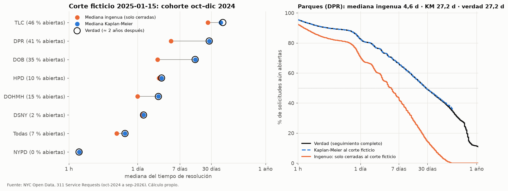

🇺🇸 **English (summary)** · 🇪🇸 [Español (full version)](README.es.md)

# How long does New York take to resolve a 311 request? · Survival analysis with censored cases

Analysis of **7,544,678 citizen requests to New York's 311** created between October 2024 and September 2026, with **survival
analysis**: the "event" is the closing of the request, and those still open at the cut-off date are **censored cases** (201,867,
2.68%), which cannot be ignored or averaged as if they had closed.

## Results in 30 seconds

- **The typical request closes in 9.0 hours** (Kaplan-Meier median, 95% CI: 8.92–8.99 h). 59.1% close within a day, 81.1% within
  a week and 4.7% are still open after 90 days. The "average" of the closed ones (8.7 days) describes nobody: a long tail drags it.
- **The average of closed cases misleads, and this is shown with real data.** Pretending a cut-off on 2025-01-15 over the Oct–Dec
  2024 cohort, the naive median for Parks (DPR) was 4.6 days; Kaplan-Meier gave **27.2 days**, and the truth, known almost two
  years later, is **27.2 days**.
- **What explains the time most is the agency and the type of complaint, not the borough.** The police (NYPD) close in **1.3 h**;
  Housing (HPD), in 4.0 days; Buildings (DOB), in 11.7 days; Parks (DPR), in 19.0 days.
- **Territorial equity: the Bronx gap is one of hours, not days.** Within the same complaint type, the probability of closing is
  13% lower at each moment than in Manhattan (stratified Cox, HR 0.87), but the effect is in the first hours.
- **The second year was somewhat slower:** 79.9% of requests closed within 7 days vs. 82.4% the previous year (−2.5 pp).

**Source and terms of use, all findings, figures and reproduction commands:** [full README (Spanish)](README.es.md). Commands are
language-independent.
