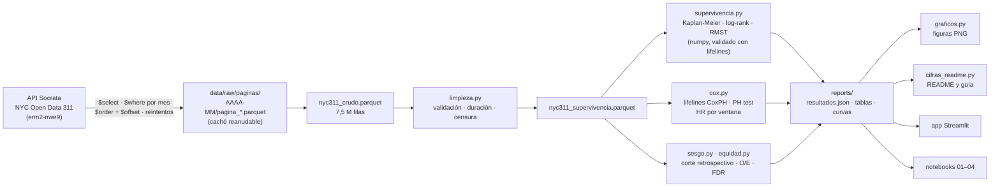

# ¿Cuánto tarda Nueva York en resolver una solicitud del 311? · Análisis de supervivencia con casos censurados


Análisis de **{{filas_limpias}} solicitudes ciudadanas al 311 de Nueva York** creadas entre octubre de 2024 y septiembre de 2026, con **análisis de supervivencia**: el «evento» es el cierre de la solicitud y las que seguían abiertas en la fecha de corte (`{{fecha_corte}}`) son **casos censurados**, no casos que se puedan ignorar ni promediar como si hubieran cerrado.

## Resultados en 30 segundos

* **La solicitud típica se cierra en {{mediana_global_h}} horas** (mediana Kaplan-Meier, IC 95 %: {{mediana_global_ic}}). El {{global_pct_cerradas_1d}} % se cierra en un día, el {{global_pct_cerradas_7d}} % en una semana y el {{global_pct_abiertas_90d}} % sigue abierta a los 90 días. El «promedio» de las cerradas ({{promedio_ingenuo_global_d}} días) no describe a nadie: lo arrastra una cola larga.
* **El promedio de las cerradas engaña, y lo demostramos con datos reales.** Fingiendo un corte el {{sesgo_corte}} sobre la cohorte de oct–dic 2024, la mediana ingenua de Parques (DPR) daba {{sesgo_dpr_ingenua}}; Kaplan-Meier daba **{{sesgo_dpr_km}}**, y la verdad, conocida casi dos años después, es **{{sesgo_dpr_verdad}}** (la ingenua se queda corta {{sesgo_dpr_veces}} veces). Hoy pasa lo mismo con Taxis y Limusinas (TLC): mediana ingenua de {{km_tlc_mediana_ingenua}} frente a **{{km_tlc}}** con Kaplan-Meier, porque el {{km_tlc_censura}} % de sus casos sigue abierto.
* **Lo que más explica el tiempo es la agencia y el tipo de queja, no el barrio.** La Policía (NYPD) cierra en **{{km_nypd}}**; Vivienda (HPD), en {{km_hpd}}; Edificios (DOB), en {{km_dob}}; Parques (DPR), en {{km_dpr}}. Entre los 20 tipos más frecuentes, la mediana va de {{tipo_mas_rapido_med}} en «{{tipo_mas_rapido}}» a {{tipo_mas_lento_med}} en «{{tipo_mas_lento}}».
* **Equidad territorial: la brecha del Bronx es de horas, no de días.** Comparando dentro del mismo tipo de queja, en el Bronx la probabilidad de cierre es en cada momento un {{hr_b_borough_bronx_pct}} % menor que en Manhattan (Cox estratificado, HR {{hr_b_borough_bronx}}). Pero el efecto está en las primeras horas: en la primera hora el Bronx cierra un {{bronx_h1_pct}} % menos de lo que predice su mezcla de quejas (O/E {{oe_h1_bronx}}), a las 24 h ya está en lo esperado (O/E {{oe_d1_bronx}}) y, entre las que siguen abiertas pasados 30 días, cierra más rápido que Manhattan (HR {{hr_bronx_ventana_3}}). **Staten Island es el único borough claramente más rápido de lo esperado a 7 días** (O/E {{oe_staten_island}}; el resto queda a menos de 0,5 % de 1).
* **El segundo año fue algo más lento.** El {{p2_pct7}} % de las solicitudes se cerró en ≤ 7 días, frente al {{p1_pct7}} % del año anterior ({{dif_pct7_pp}} pp), y el empeoramiento se mantiene después de ajustar por la mezcla de quejas (O/E {{p1_oe}} → {{p2_oe}}). El pico de cada invierno (mediana de {{mes_mediana_max_h}} h en {{mes_mediana_max}} frente a {{mes_mediana_min_h}} h en {{mes_mediana_min}}) se explica por la mezcla: en {{calef_max_mes}}, las quejas de calefacción son el {{calef_max_pct}} % del total.


---

## 1. Fuente de datos y licencia

| Elemento | Detalle |
| :--- | :--- |
| Dataset | [311 Service Requests from 2010 to Present](https://data.cityofnewyork.us/Social-Services/311-Service-Requests-from-2010-to-Present/erm2-nwe9) · NYC Open Data (id `erm2-nwe9`) |
| Acceso | API Socrata `https://data.cityofnewyork.us/resource/erm2-nwe9.csv`, sin clave, con `$select` (10 columnas), `$where` por mes, `$order=unique_key`, `$limit`/`$offset` |
| Ventana | Solicitudes creadas del 01-10-2024 al 30-09-2026 · descarga del {{fecha_descarga}} · corte de censura `{{fecha_corte}}` |
| Términos de uso | Datos públicos de la Ciudad de Nueva York, sujetos a los [NYC.gov Terms of Use](https://www.nyc.gov/home/terms-of-use.page): uso libre, sin garantía de exactitud y sin respaldo de la ciudad a los análisis de terceros. Detalle y cita sugerida en [`docs/fuentes.md`](docs/fuentes.md). |
| Qué se versiona | Solo agregados (`reports/`) y 5 filas grabadas de la API para las pruebas. Los datos crudos (93 MB) se descargan con `python descargar_datos.py`. |
| Licencia | El **código** es [MIT](LICENSE) (© 2026 Erick Guarnizo). Los **datos** siguen los términos de NYC Open Data. Las cifras son cálculo propio, no estadísticas oficiales. |

---

## 2. Hallazgos

### 2.1 Evento, censura y calidad de datos

* **Evento** = la solicitud tiene `status = Closed` y una `closed_date` no posterior al corte. **Censura** = cualquier otro caso: al corte seguía abierta y solo sabemos que tardó **al menos** `corte − creación`.
* La censura es **administrativa**: solo la produce la fecha de corte; ninguna solicitud se «pierde» antes. Por eso es no informativa (supuesto clave de Kaplan-Meier y Cox) y un resultado como «¿cerró en ≤ 7 días?» está observado para toda la cohorte, que termina 26 días antes del corte.
* De {{filas_crudas}} filas quedan **{{filas_limpias}}**: {{eventos_cerradas}} cierres y **{{censuradas_abiertas}} censuradas ({{pct_censuradas}} %)**.

| Problema | Casos | Decisión |
| :--- | ---: | :--- |
| Cierre antes de la apertura (fecha imposible) | {{cierre_antes_de_apertura}} | Se descartan (el {{imposibles_dot_dep_pct}} % son de DOT y DEP) |
| `Closed` sin fecha de cierre | {{cerradas_sin_fecha_cierre}} | Se descartan: sabemos que cerró, no cuándo |
| Fecha de cierre pero estado abierto (probablemente reabiertas) | {{fecha_cierre_con_estado_abierto}} | Censura al corte: manda el estado |
| Cierre posterior al corte | {{cierre_posterior_al_corte}} | Censura al corte |
| Cierre instantáneo (duración 0) | {{cierres_instantaneos}} | Se conservan y se marcan: son cierres administrativos reales |
| ZIP nulo o fuera de NYC · borough sin dato | {{zip_invalido_o_nulo}} · {{borough_sin_dato}} | Se conservan; solo salen de los análisis territoriales |
| `unique_key` duplicado | {{duplicados_unique_key}} | — |


### 2.2 Por qué no usar el promedio de las cerradas

El promedio de las solicitudes cerradas tiene **dos** problemas: (1) **descarta las abiertas**, que son justamente las lentas, y (2) aun sin censura, la distribución tiene una cola enorme ({{global_pct_cerradas_1d}} % se cierra en un día, pero hay casos de meses), así que la media no representa al caso típico. Tratar las abiertas como «cerradas al corte» tampoco sirve: las acorta.

**Experimento de corte retrospectivo.** Para no depender de una simulación, se tomó la cohorte creada en oct–dic 2024 y se reconstruyó lo que habríamos visto si la descarga se hubiera hecho el **{{sesgo_corte}}**. Se compara con la «verdad» que conocemos hoy, casi sin censura:

| Agencia | Solicitudes | Abiertas al corte ficticio | Mediana ingenua | Mediana KM | Mediana real | Promedio ingenuo | Promedio real |
| :--- | ---: | ---: | ---: | ---: | ---: | ---: | ---: |
{{tabla_sesgo}}

* Donde hay mucha censura, la mediana ingenua se queda muy corta (DOB: {{sesgo_dob_ingenua}} frente a {{sesgo_dob_verdad}} reales) y **Kaplan-Meier la recupera** ({{sesgo_dob_km}}). El promedio ingenuo es aún peor: {{sesgo_dob_prom_ingenuo}} frente a {{sesgo_dob_prom_verdad}}.
* Con la Corporación de Desarrollo Económico (EDC), el {{sesgo_edc_abiertas}} % seguía abierto: Kaplan-Meier responde **«mediana no alcanzada»**, que es lo honesto. El promedio ingenuo ({{sesgo_edc_prom_ingenuo}}) inventa una respuesta; la real era {{sesgo_edc_verdad}}.
* En NYPD, con casi cero censura, todos los métodos coinciden: el sesgo aparece solo donde hay censura.

### 2.3 Kaplan-Meier por agencia, tipo de queja, borough y canal

Las 10 agencias con más solicitudes (IC 95 % de la mediana por el método de Brookmeyer-Crowley sobre la banda log(−log)):

| Agencia | Solicitudes | % censuradas | Mediana KM (IC 95 %) | Cerradas en 7 días | En 30 días | Promedio ingenuo |
| :--- | ---: | ---: | :--- | ---: | ---: | ---: |
{{tabla_agencias}}


* **Canal:** por app móvil la mediana es {{km_canal_app}} y por web {{km_canal_web}}, frente a {{km_canal_telefono}} por teléfono. No es que el teléfono «funcione peor»: el {{pct_hpd_telefono}} % de lo que llega por teléfono son quejas de vivienda (HPD), que tardan días, frente al {{pct_hpd_app}} % en la app, donde el {{pct_nypd_app}} % son asuntos policiales que se cierran en horas. El modelo de Cox separa ambos efectos (sección 2.4).
* **Borough sin ajustar:** Queens {{km_queens}}, Brooklyn {{km_brooklyn}}, Bronx {{km_bronx}}, Manhattan {{km_manhattan}}, Staten Island {{km_staten_island}}. Manhattan aparece entre los más lentos por su mezcla de quejas, y este orden cambia al ajustar.


**Pruebas log-rank** (H0: misma curva en todos los grupos). Con millones de filas todo es «significativo»: la prueba descarta el azar, pero **el tamaño del efecto** se lee en las medianas y en los HR, no en el p-valor.

| Comparación | Grupos | χ² | gl | p-valor |
| :--- | ---: | ---: | ---: | ---: |
{{tabla_logrank}}

### 2.4 Modelo de Cox y supuesto de riesgos proporcionales

El «riesgo» es la tasa instantánea de **cierre**: **HR > 1 = se cierra más rápido** que la referencia; HR < 1, más lento. Se ajustan dos modelos con `lifelines` en una muestra aleatoria de {{cox_n}} solicitudes:

* **Modelo A** (agencia + borough + canal + horario; C = {{cox_c_a}}): la agencia domina. Frente a NYPD, una solicitud de Parques tiene en cada momento un {{hr_a_agencia_dpr_pct}} % menos de probabilidad de cerrarse (HR {{hr_a_agencia_dpr}}); una de Vivienda (HPD), un {{hr_a_agencia_hpd_pct}} % menos (HR {{hr_a_agencia_hpd}}).
* **Modelo B** (estratificado por tipo de queja; C = {{cox_c_b}}): cada tipo de queja tiene su propio riesgo base, así que los boroughs se comparan **dentro del mismo tipo**. Su concordancia es baja a propósito: ya no «gana» prediciendo con el tipo de queja.

| Covariable (modelo B) | HR (IC 95 %) | Lectura de negocio |
| :--- | :--- | :--- |
{{tabla_cox_b}}

Referencias: Manhattan, teléfono, día laborable de 6 h a 22 h.


**¿Se cumple el supuesto de riesgos proporcionales (PH)? No del todo, y eso es un hallazgo.**

1. *Prueba de Grambsch-Therneau* (residuos de Schoenfeld escalados, 40.000 filas): en el modelo A, la mayor violación es `{{ph_a_max_cov}}` (χ² = {{ph_a_max_est}}), y {{ph_a_n_agencias_top5}} de las 5 mayores son agencias. Por eso el modelo B **estratifica** por tipo de queja en vez de estimar un HR por agencia. En el modelo B, la mayor es `{{ph_b_max_cov}}` (χ² = {{ph_b_max_est}}).
2. *Curvas log(−log S)* por borough: no son paralelas.
3. *HR por ventana de tiempo*: reestimando el modelo B solo con las solicitudes aún abiertas al inicio de cada ventana, el HR del Bronx pasa de **{{hr_bronx_ventana_0}}** ({{ventana_0}}) a {{hr_bronx_ventana_1}} ({{ventana_1}}), {{hr_bronx_ventana_2}} ({{ventana_2}}) y **{{hr_bronx_ventana_3}}** ({{ventana_3}}). **Lectura de negocio:** en el Bronx cuesta más que una queja se cierre en las primeras horas, pero entre las que siguen abiertas pasada una semana se cierran más rápido que en Manhattan. El HR global ({{hr_b_borough_bronx}}) es un promedio de ambas fases, dominado por el primer día, cuando ocurre la mayoría de los cierres.


### 2.5 Equidad territorial: ¿se atiende más lento en ciertos barrios?

Para una medida que no dependa del supuesto PH se usa **estandarización indirecta**: para cada solicitud, la probabilidad «esperada» de cerrarse dentro de un horizonte (1 hora, 8 horas, 1 día, 7 días) es la de toda la ciudad en su celda **tipo de queja × descriptor**. Un **O/E** (observado/esperado) menor que 1 significa que el borough o el ZIP cierra menos de lo que su mezcla de quejas predice.

| Borough | Solicitudes | Cerradas ≤ 7 d | Esperado ≤ 7 d | **O/E 7 d** (IC 95 %) | O/E ≤ 1 h | O/E ≤ 8 h | O/E ≤ 1 día |
| :--- | ---: | ---: | ---: | :--- | ---: | ---: | ---: |
{{tabla_equidad}}

* **Sin ajustar, Manhattan parece el más lento** ({{pct7_manhattan}} % en 7 días); ajustado por su mezcla, está prácticamente en lo esperado. A 7 días el Bronx (O/E {{oe_bronx}}) y Brooklyn ({{oe_brooklyn}}) quedan apenas por debajo, Manhattan apenas por encima ({{oe_manhattan}}) y Staten Island claramente por encima ({{oe_staten_island}}).
* **La brecha del Bronx está en las primeras horas:** su O/E es {{oe_h1_bronx}} a 1 hora, {{oe_h8_bronx}} a 8 horas y {{oe_d1_bronx}} a 1 día. Es el mismo patrón que muestran los HR por ventana del modelo de Cox, ahora sin el supuesto PH. Para un gerente, la pregunta útil no es «¿el Bronx es más lento?», sino «¿por qué la primera respuesta tarda más?» (una hipótesis por investigar, que estos datos no permiten confirmar: la carga de patrullas de NYPD en las horas pico de quejas de ruido).
* **Códigos postales:** de {{n_zip_analizados}} ZIP con al menos 1.000 solicitudes, {{n_zip_significativos}} se desvían de lo esperado con una tasa de falsos descubrimientos del 5 % (Benjamini-Hochberg): {{n_zip_lentos}} más lentos y {{n_zip_rapidos}} más rápidos. Las desviaciones son pequeñas (90 % de los ZIP entre {{oe_zip_p05}} y {{oe_zip_p95}}). {{n_zip_rapidos_si}} de los {{n_zip_rapidos}} ZIP más rápidos ({{pct_rapidos_en_si}} %) están en Staten Island, que recibe apenas el {{pct_solicitudes_si}} % de las solicitudes.

| ZIP | Borough | Solicitudes | Cerradas ≤ 7 d | Esperado | O/E |
| :--- | :--- | ---: | ---: | ---: | ---: |
{{tabla_zip}}

El ZIP más lento es el {{zip_mas_lento}} (O/E {{zip_mas_lento_oe}}).{{nota_zip_mas_lento}}


> **Correlación no es causalidad.** Un O/E bajo es compatible con menos recursos, pero también con casos más difíciles dentro de la misma celda (edificios más viejos, problemas recurrentes), con quejas repetidas que se cierran juntas, con diferencias en cómo cada agencia registra el «cierre» o con quién reporta (el 311 mide demanda reportada, no necesidad real). Sin datos socioeconómicos no se puede atribuir la diferencia a ingreso ni a composición del barrio.

### 2.6 Evolución en el tiempo: ¿mejora o empeora?

| Periodo | Mediana KM | Cerradas ≤ 7 días | O/E ajustado por mezcla |
| :--- | ---: | ---: | ---: |
| {{periodo1}} | {{p1_mediana_h}} h | {{p1_pct7}} % | {{p1_oe}} |
| {{periodo2}} | {{p2_mediana_h}} h | {{p2_pct7}} % | {{p2_oe}} |

* **Estacionalidad:** la mediana mensual sube cada invierno (máximo {{mes_mediana_max_h}} h en {{mes_mediana_max}}; mínimo {{mes_mediana_min_h}} h en {{mes_mediana_min}}) porque cambia la mezcla: las quejas de calefacción y agua caliente pasan del {{calef_min_pct}} % de las solicitudes ({{calef_min_mes}}) al {{calef_max_pct}} % ({{calef_max_mes}}), y se resuelven en días, no en horas.
* **Tendencia:** ajustando por la mezcla, el O/E mensual pasa de {{mes_oe_max_val}} ({{mes_oe_max}}) a {{mes_oe_min_val}} ({{mes_oe_min}}). El segundo año es un poco más lento, pero la diferencia es de unos pocos puntos.

| Agencia | Mediana año 1 | Mediana año 2 | Cambio |
| :--- | ---: | ---: | ---: |
{{tabla_agencias_anual}}

* **Cuidado con leer la tabla como desempeño:** el salto de Salud (DOHMH, de {{anual_dohmh_1}} a {{anual_dohmh_2}}) es sobre todo un **cambio de proceso**. Los cierres instantáneos de DOHMH bajaron del {{dohmh_inst_1}} % al {{dohmh_inst_2}} % (en roedores, del {{roedor_inst_1}} % al {{roedor_inst_2}} %), y el {{comida_60d}} % de las quejas de establecimientos de comida se cierra a los **60,0 días exactos**, un cierre administrativo por plazo (la caída vertical de la figura 03). El «tiempo hasta el cierre» mide el registro administrativo, no necesariamente la solución del problema.


---

## 3. Arquitectura



## 4. Decisiones técnicas

| Decisión | Por qué |
| :--- | :--- |
| Kaplan-Meier y log-rank **propios** en numpy (`src/nyc311/supervivencia.py`) | Con 7,5 M de filas y duraciones al segundo hay millones de tiempos distintos. Agregar con `np.unique` + `np.bincount` y acumular el log-rank por bloques mantiene la RAM acotada. Las pruebas comprueban que coinciden con lifelines (diferencia < 1e-10) y con el ejemplo de libro de Freireich (χ² = 16,79). |
| `lifelines` para Cox, en una muestra de {{cox_n}} | Ajustar Cox con empates (Efron) en 7,5 M de filas es lento y pesado. Con 200.000 filas los IC de los HR ya miden ±1–3 %, y el ajuste tarda unos 30 s. |
| Fecha de corte = última `created_date` publicada, fija en un manifiesto | El dataset se actualiza a diario: un cierre posterior a esa actualización aún no existe en la API. Usar el reloj local inflaría la duración de las abiertas. Fijarla en el manifiesto mantiene la definición aunque la descarga se reanude días después. |
| Estratificar por tipo de queja (modelo B) | La agencia y el tipo de queja violan PH con fuerza. Estratificar deja a cada tipo su propio riesgo base, sin imponerle forma, y compara boroughs dentro del mismo tipo. |
| HR por ventana con truncamiento por la izquierda (`entry_col`) | Muestra **cómo** se viola PH en lenguaje de negocio, en lugar de solo reportar un p-valor que, con este n, siempre es ≈ 0. |
| O/E con estandarización indirecta a 7 días | Es una medida de equidad sin supuesto PH, comprensible para gestión, y sin sesgo por censura: el resultado está observado para todas las solicitudes. |
| Benjamini-Hochberg para los ZIP | Con 181 comparaciones, un umbral de 5 % sin corregir produciría unos 9 falsos positivos por azar. |
| README y guía generados desde `reports/` | Ninguna cifra se escribe a mano; `tests/test_cifras_readme.py` falla si el texto se desfasa de los resultados. |

## 5. Limitaciones

* **El «cierre» es administrativo.** Algunas agencias cierran por plazo (comida a los 60 días), derivan (cierres instantáneos) o cierran en bloque. Un cambio de proceso mueve la mediana sin que cambie la atención real (sección 2.6).
* **Observacional, no causal.** Cox y O/E controlan el tipo de queja, el canal y el horario, pero no la gravedad dentro de cada tipo, la antigüedad de los edificios ni los recursos de cada distrito.
* **Supuesto PH violado parcialmente.** Los HR globales son promedios en el tiempo; las conclusiones de equidad se apoyan también en el O/E y en los HR por ventana.
* **Reaperturas.** Las {{fecha_cierre_con_estado_abierto}} solicitudes con fecha de cierre y estado abierto se tratan como censuradas. Si en realidad hubo un primer cierre, se subestima un poco la rapidez de esas agencias.
* **Cohortes recientes.** Los meses de 2026 tienen menos seguimiento. Kaplan-Meier lo maneja, pero si alguna agencia registra cierres con retraso, los últimos meses se verían algo más lentos.
* **Cox en muestra.** Los HR provienen de 200.000 solicitudes (semilla fija); los demás resultados usan todas.

## 6. Cómo reproducir

```bash
python -m venv .venv
.venv\Scripts\activate            # Windows  (Linux/macOS: source .venv/bin/activate)
pip install -r requirements.txt
pip install -e .

python descargar_datos.py         # ~15 min, 93 MB; reanudable si se corta
python -m nyc311.pipeline         # ~5 min, pico de ~4 GB de RAM: limpieza, análisis, tablas y figuras
python -m nyc311.cifras_readme    # regenera README y guía desde reports/
python scripts/crear_notebooks.py
jupyter nbconvert --to notebook --execute --inplace notebooks/*.ipynb
pytest -q                         # pruebas (no usan red)
streamlit run app/streamlit_app.py
```

La app solo lee archivos versionados de `reports/tablas/`, así que funciona sin descargar los datos.

## 7. Estructura

```
├── descargar_datos.py            # descarga reanudable (envoltorio de nyc311.descarga)
├── src/nyc311/
│   ├── descarga.py               # API Socrata: paginación, reintentos, caché, manifiesto
│   ├── limpieza.py               # validación, evento y censura
│   ├── supervivencia.py          # Kaplan-Meier, IC, mediana, RMST, log-rank
│   ├── sesgo.py                  # experimento de corte retrospectivo
│   ├── cox.py                    # Cox A/B, prueba PH, HR por ventana
│   ├── equidad.py                # O/E estandarizado, Benjamini-Hochberg
│   ├── pipeline.py · graficos.py · cifras_readme.py · etiquetas.py · config.py
├── notebooks/                    # 01 ingesta y calidad · 02 Kaplan-Meier · 03 Cox · 04 hallazgos
├── app/streamlit_app.py          # curva por tipo de queja y borough
├── reports/                      # resultados.json, tablas/, figures/
├── scripts/                      # plantillas del README y generador de notebooks
├── tests/                        # pytest (respuestas grabadas de la API en tests/datos/)
└── docs/                         # GUIA_PASO_A_PASO.md · fuentes.md
```
