🇪🇸 **Español** · 🇬🇧 [English (summary)](README.en.md)

# 🌋 ¿Cada cuánto tiembla fuerte en el Ecuador? Sismicidad y Cinturón de Fuego con el catálogo del USGS

Consumo la **API FDSN del USGS** (paginada, con reintentos y caché) para armar tres catálogos: **3.214 sismos M≥2,5 del Ecuador ampliado (1970–2025)**, **87.784 sismos M≥5 del mundo (1973–2025)** para comparar **13 zonas del Cinturón de Fuego**, y los M≥6 desde 1900. Con ellos homogeneízo las magnitudes, ajusto la **ley de Gutenberg-Richter** (Mc y valor b por máxima verosimilitud con IC 95 %), estimo **periodos de retorno de M≥6 y M≥7** y ajusto la **ley de Omori-Utsu** a las réplicas del **terremoto de Pedernales 2016 (M7,8)**.

> ⚠️ **La estadística sísmica estima frecuencias medias de largo plazo. No predice cuándo ni dónde será el próximo terremoto.**


---

## 📌 Preguntas que responde

| # | Pregunta | Técnica | Respuesta |
|---|---|---|---|
| 1 | ¿Dónde se concentran los sismos? | Mapas por profundidad, corte este–oeste | **58 %** son superficiales (<70 km), en la costa: el contacto entre placas. El **42 %** restante es intermedio (70–300 km) bajo la Sierra y la Amazonía: la **placa de Nazca hundiéndose** (nido de 100–200 km bajo Puyo–Macas) |
| 2 | ¿Qué valor b tiene el Ecuador? | Aki-Utsu + Shi-Bolt + bootstrap; Mc por MAXC y por estabilidad de b | **b = 0,85 [0,72–0,97]** con Mc = 5,6. Con el Mc "de libro" (5,0) sale 1,30, pero es un **artefacto** de mezclar escalas mb y Mw |
| 3 | ¿Es distinto del resto del Cinturón? | Mismo catálogo y método en 13 zonas, Mc común 5,5 | Ecuador tiene el **b más bajo (0,88 [0,76–1,01])**: proporcionalmente más sismos grandes. Su IC 95 % no se solapa con el de 10 de las otras 12 zonas; solo con México y Colombia–Panamá |
| 4 | ¿Cada cuánto un M≥7 en la región? | Gutenberg-Richter desagrupado + Poisson; línea base: contar | **Cada 5,0 años en promedio [3,3–8,5]**: probabilidad anual **18 % [11–26 %]**. El conteo real da 3,5 años (1970–2025) y 5,0 años (1900–2025) |
| 5 | ¿Y un M≥7 superficial, del tipo de Pedernales? | Lo mismo, solo profundidad <70 km | **Cada 10,4 años [6,0–21,9]** (9 % al año); se observaron 7 en 56 años (8,0 años) |
| 6 | ¿Cómo decayeron las réplicas de Pedernales? | Omori-Utsu por máxima verosimilitud (Ogata) vs exponencial | **p = 0,91 ± 0,08**, c = 0,09 días: no se distingue de la ley de Omori original (p = 1). El modelo exponencial pierde por **ΔAIC = 80**. El **53 %** de las réplicas M≥4,9 del año llegó en la primera semana |

## 🏗️ Arquitectura

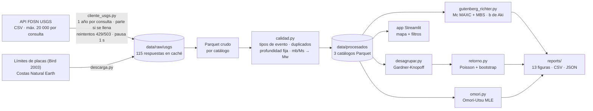

Un comando ejecuta todo (descarga incluida, reanudable): `python -m sismos.pipeline`

## 🧹 Ingeniería y calidad de datos

| Problema real | Solución |
|---|---|
| La API devuelve **máx. 20 000 eventos** por consulta (el mundo con M≥2 en un año son ~40 000) | Una consulta por año; si la API responde `400 … exceeds search limit` o llega una página llena, el intervalo se **parte en dos** recursivamente |
| La PC se apaga y el internet se cae | Cada respuesta se guarda en `data/raw/usgs/` con escritura atómica; volver a correr **solo pide lo que falta** (2.ª corrida: 56 de 56 años de Ecuador desde caché) |
| Respetar el servicio | 1 s de pausa entre llamadas, `Retry-After` en 429/503, nada se pide dos veces. Total: **115 consultas** |
| Fronteras de intervalos inclusivas en la API | `drop_duplicates("id")` al unir |
| **Escalas mezcladas**: en Ecuador el **83 % es mb**, 12 % Mw, 4 % magnitudes locales | mb y Ms → Mw con **Scordilis (2006)**; mb sube en promedio **+0,36** al pasar a Mw. Local ≈ Mw (supuesto documentado) |
| Convertir mb redondeado a 0,1 crea **picos falsos** cada pocas clases de Mw, que engañan a la máxima curvatura | Cada magnitud se reparte al azar (semilla fija) dentro de su clase de reporte antes de convertir ([figura](reports/figures/01_calidad_magnitudes.png)) |
| **Profundidad fija** (10/33/35 km): 25,8 % en Ecuador, 31,4 % en el mundo | Se marca y no se imputa; se excluye del corte de subducción |
| Explosiones nucleares (425), erupciones (55) y otros en el catálogo mundial | Solo `type == earthquake` |
| Mismo sismo con dos `id` (dos redes) | Casi duplicados a <16 s y <50 km: 1 en Ecuador, 82 en el mundo; se queda el de mejor magnitud |
| Réplicas que violan el supuesto de Poisson | **Gardner-Knopoff**: quita el 48,4 % del catálogo de Ecuador antes de calcular periodos de retorno |

## 📊 Resultados

### 1 · Dónde tiembla: la subducción de la placa de Nazca

| Mapa de epicentros (color = profundidad) | Corte este–oeste (2,5°S–1,5°N) |
|---|---|
| 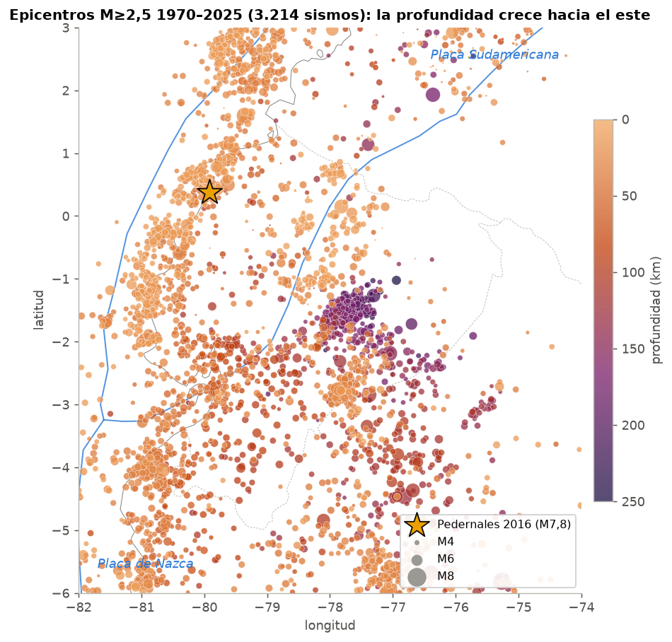 | 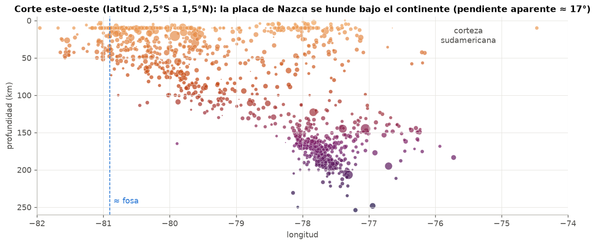 |

* **3.214 sismos** M≥2,5 en 1970–2025: 1.280 de M≥5, **73 de M≥6 y 16 de M≥7**. El mayor no fue Pedernales sino el **M8,0 de 2019 en el norte del Perú, a 123 km de profundidad**.
* Los sismos someros forman una franja paralela a la costa (la interfaz de subducción, donde ocurrieron 1906, 1942, 1958, 1979 y 2016). Hacia el este la profundidad crece: la regresión de profundidad sobre la distancia da una **pendiente aparente de ~16°** (aproximación gruesa: mezcla latitudes y usa la longitud, no la distancia a la fosa).
* **2016** fue el año más activo (**201 sismos**, la mediana es 48) por las réplicas de Pedernales.

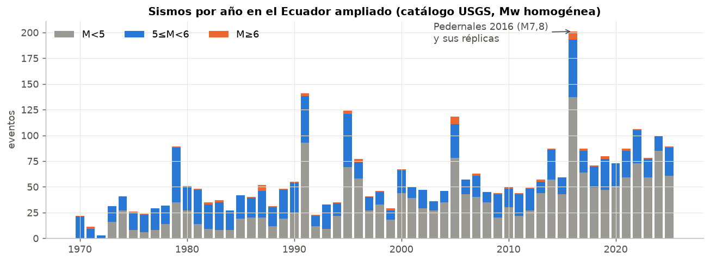

### 2 · Gutenberg-Richter: el Mc "de libro" engaña

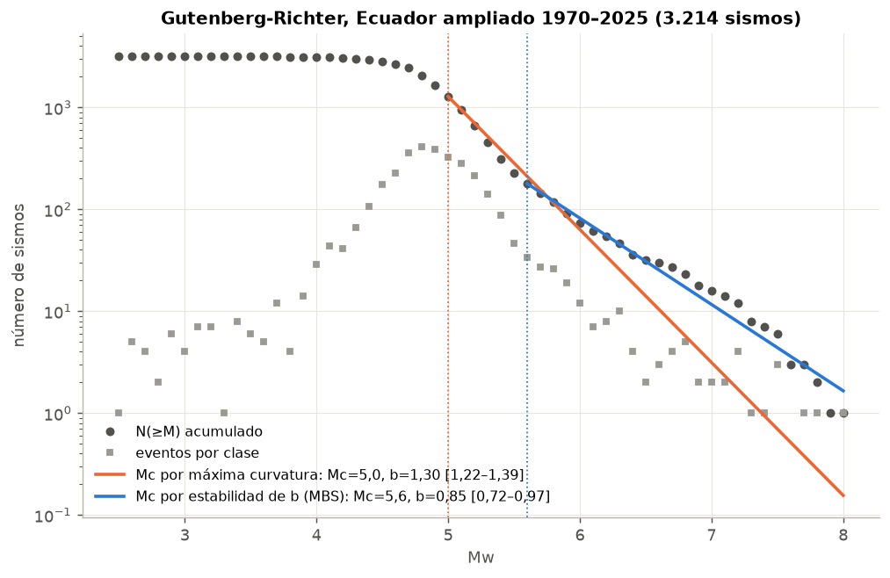

| Ecuador 1970–2025 | Mc | Sismos ≥ Mc | b de Aki [IC 95 % Shi-Bolt] | IC 95 % bootstrap | b mínimos cuadrados (línea base) |
|---|---:|---:|---:|---:|---:|
| Máxima curvatura + 0,2 | 5,0 (±0,05) | 1.280 | 1,30 [1,22–1,39] | [1,23–1,40] | 0,91 |
| **Estabilidad de b (MBS)** | **5,6** | **179** | **0,85 [0,72–0,97]** | [0,74–1,00] | 0,87 |

* Con Mc = 5,0 el valor b sale 1,30, pero **no es estable**: baja hasta ~0,85 a partir de M5,5 ([figura](reports/figures/07_estabilidad_valor_b.png)). Debajo de M5,5 casi todo es mb convertida; arriba, Mw medida. La conversión promedio de Scordilis no alcanza a unir las dos escalas y la distribución se dobla.
* El criterio **MBS** (Cao y Gao, 2002) elige Mc = 5,6. Las **pruebas con datos simulados** confirman el patrón: con una rampa de detección ancha, MAXC subestima Mc (3,6–3,7 cuando el real es 4,0) y MBS lo acierta (3,9–4,0).
* La línea base de **mínimos cuadrados** da 0,91 con Mc = 5,0: no detecta el problema y además no tiene un error estándar válido (los puntos acumulados no son independientes).
* **La prueba de fuego** es la línea base de conteo: con Mc = 5,0 la recta predice un M≥7 cada **15,5 años**, cuando en 1970–2025 hubo **16** (uno cada 3,5 años). Con Mc = 5,6 predice uno cada **5,0 años**, compatible con lo observado.

### 3 · Ecuador frente al Cinturón de Fuego

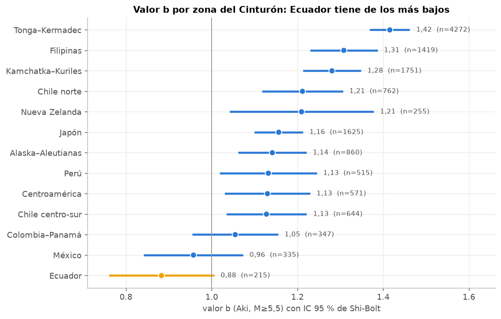

| Zona (mundo M≥5, 1973–2025) | Sismos M≥5 | M≥7 | % a >70 km | b (M≥5,5) [IC 95 %] |
|---|---:|---:|---:|---:|
| **Ecuador** | 540 | 14 | 28,0 | **0,88 [0,76–1,01]** |
| México | 765 | 23 | 11,1 | 0,96 [0,84–1,07] |
| Colombia–Panamá | 842 | 7 | 17,6 | 1,05 [0,95–1,16] |
| Perú | 1.292 | 21 | 37,3 | 1,13 [1,02–1,25] |
| Japón | 3.972 | 32 | 11,8 | 1,16 [1,10–1,21] |
| Chile norte | 1.949 | 16 | 54,4 | 1,21 [1,12–1,31] |
| Tonga–Kermadec | 10.062 | 60 | 34,3 | 1,42 [1,37–1,46] |

(Las 13 zonas en [`reports/valor_b_cinturon.csv`](reports/valor_b_cinturon.csv).)

* Un b bajo significa **más sismos grandes por cada sismo pequeño**. Ecuador está en el extremo bajo del Cinturón, lo que es coherente con una interfaz que acumula esfuerzo y lo libera en sismos grandes (1906 M8,8; 1979 M7,7; 2016 M7,8). Ojo: su catálogo M≥5,5 tiene solo 215 sismos, y por eso su IC es ancho.
* **Línea base contra modelo:** al extrapolar la recta desde M5,5 hasta M7, Gutenberg-Richter **se queda corto en 12 de 13 zonas** (mediana: hay **1,38 veces** más M≥7 de los que predice). Donde b es alto por la mezcla mb/Mw (Tonga, Filipinas, Kamchatka) el error llega a ×1,8–2,4. En Ecuador: 0,19 M≥7/año predichos frente a 0,26 observados.

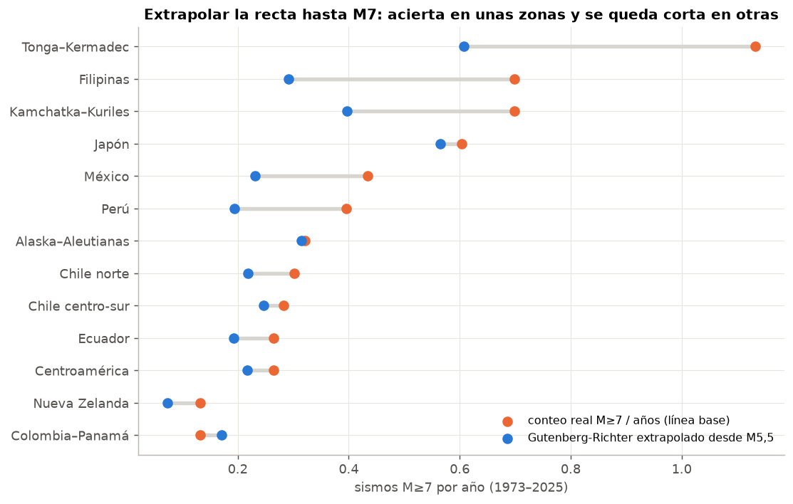

### 4 · Periodos de retorno en el Ecuador ampliado

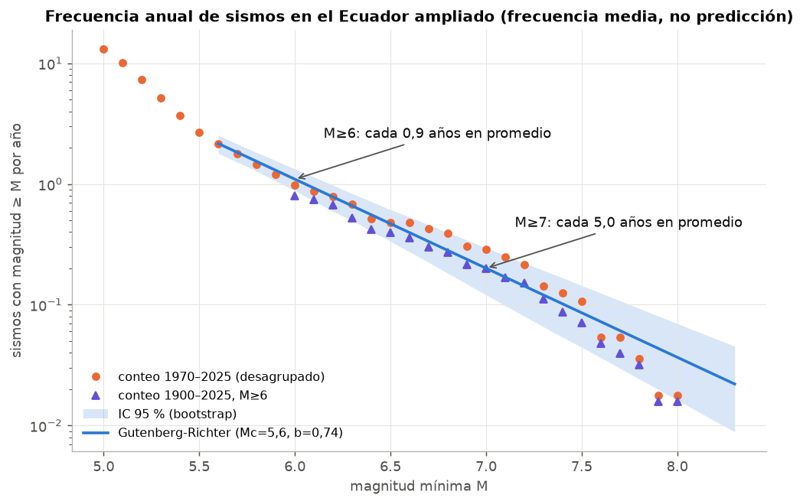

| Modelo (Mc = 5,6, 1970–2025) | M≥6: retorno [IC 95 %] | P(M≥6 en un año) | M≥7: retorno [IC 95 %] | P(M≥7 en un año) |
|---|---:|---:|---:|---:|
| **Gutenberg-Richter, desagrupado** (b = 0,74) | **0,9 años [0,8–1,2]** | **67 % [58–74 %]** | **5,0 años [3,3–8,5]** | **18 % [11–26 %]** |
| Gutenberg-Richter, con réplicas (b = 0,85) | 0,7 años [0,6–0,8] | 77 % [70–83 %] | 4,8 años [3,3–8,0] | 19 % |
| Solo superficiales (<70 km), desagrupado | 1,6 años [1,3–2,2] | 45 % [36–55 %] | 10,4 años [6,0–21,9] | 9 % |
| *Línea base: conteo 1970–2025* | 1,0 años (55 eventos principales tras desagrupar) | 63 % | 3,5 años (16) [2,2–6,1] | 25 % |
| *Línea base: conteo 1900–2025* | — | — | 5,0 años (25) [3,4–7,8] | 18 % |
| *Con el Mc de máxima curvatura (5,0)* | 1,1 años | 60 % [51–68 %] | **15,5 años** ❌ | 6 % |

Los 55 sismos de la línea base de M≥6 son los **eventos principales que quedan tras desagrupar** (Gardner-Knopoff); el catálogo completo tiene 73 de M≥6, réplicas incluidas.

**Cómo leerlo:** "cada 5 años en promedio" quiere decir que, a largo plazo, en una región de 9° × 8° que incluye el norte del Perú y el sur de Colombia ocurren unos dos M≥7 por década. **No** quiere decir que el próximo llegue en 5 años, ni que tras un sismo grande haya "pasado el peligro": el modelo de Poisson no tiene memoria. Los periodos de retorno de una ciudad concreta son mucho más largos que los de toda la región, y para el diseño sísmico se usa otra herramienta (análisis probabilista de peligro sísmico, con la aceleración del suelo y no la magnitud).

### 5 · Las réplicas de Pedernales 2016 siguen la ley de Omori

| Mapa (≤150 km, año siguiente) | Tasa y conteo acumulado |
|---|---|
| 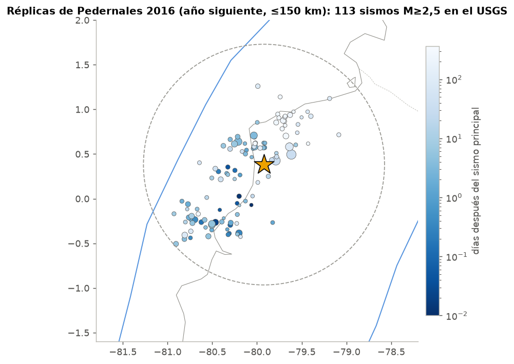 | 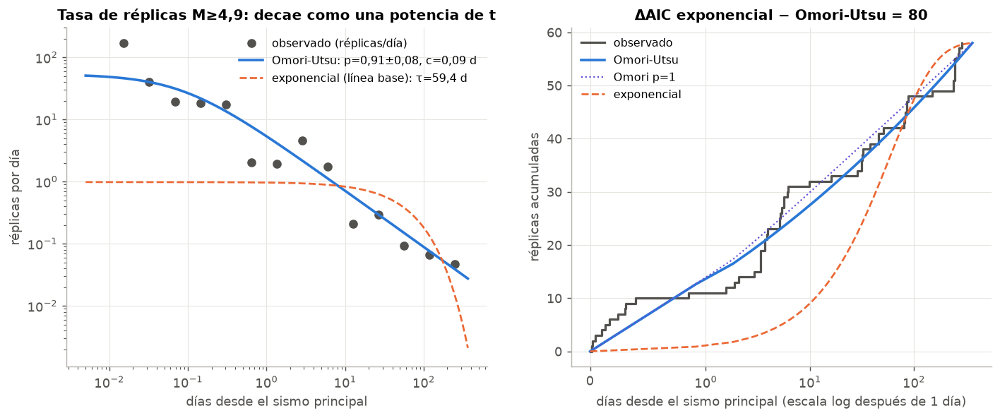 |

| Modelo (58 réplicas M≥4,9) | Parámetros | log L | AIC |
|---|---|---:|---:|
| **Omori-Utsu** λ = K/(t+c)^p | K = 5,8 ± 1,8 · c = 0,09 ± 0,11 días · **p = 0,91 ± 0,08** | −75,3 | 156,7 |
| Omori original (p = 1) | K = 7,9 ± 1,3 · c = 0,23 ± 0,15 días | −75,8 | **155,7** |
| *Exponencial (línea base)* | τ = 59 días | −116,5 | 236,9 |

* El USGS registró **113 réplicas M≥2,5** a ≤150 km en el año siguiente; Mc = 4,9 por máxima curvatura. El exponente **p = 0,91 ± 0,08** es compatible con 1 (y con p = 1 el AIC incluso mejora un punto: el parámetro extra no se justifica).
* La sensibilidad al umbral es baja: **p entre 0,91 y 0,99** con Mc de 4,5 a 5,0.
* La mayor réplica fue **M6,9 el 18 de mayo de 2016 (día 32)**: ΔM = 0,9 respecto al principal, cerca del 1,2 de la **ley de Båth**.

## 🧠 Decisiones técnicas

| Decisión | Por qué |
|---|---|
| Consultar **por año** y partir solo si hace falta | El caso típico cabe en una llamada; partir en meses fijos multiplicaría las llamadas sin necesidad |
| Mundo M≥5 completo y recortar zonas en local | 53 consultas en vez de 13 × 53 que además se solaparían |
| **Mc por estabilidad de b**, no solo por máxima curvatura | MAXC es el método más usado, pero en un catálogo con escalas mezcladas da un b que contradice el conteo real de M≥7 |
| b por **máxima verosimilitud** (Aki-Utsu), no mínimos cuadrados | Es el estimador insesgado y con error conocido; mínimos cuadrados queda como línea base |
| Dos IC para b (Shi-Bolt y bootstrap) | Coinciden en todos los casos; el bootstrap no supone normalidad |
| Desagrupar (Gardner-Knopoff) antes del retorno | Poisson exige sismos independientes; con réplicas la tasa de M≥6 se infla un 34 % |
| Omori por **máxima verosimilitud** con K en forma cerrada | Ajustar por mínimos cuadrados un histograma depende de cómo se armen las clases; la verosimilitud usa cada tiempo exacto |
| Comparar con AIC contra p = 1 y exponencial | Un buen ajuste no basta: hay que ganarle a algo más simple |
| Mapas con matplotlib + GeoJSON (sin cartopy) | Menos dependencias; las capas son opcionales y el pipeline funciona sin ellas |
| App con **pydeck** y Altair de una sola capa | Plotly y Altair con capas no se dibujan en el Streamlit 1.66 de Python 3.14; pydeck sí |

## ⚠️ Limitaciones

* **No es una predicción** ni un estudio de peligro sísmico: no hay aceleraciones del suelo, ni efectos de sitio, ni fuentes sísmicas separadas.
* El **catálogo mundial del USGS** en el Ecuador solo es completo desde M~5 (para el valor b, desde M5,6). La red del **IG-EPN** registra miles de sismos más pequeños, pero no publica una API abierta equivalente.
* La conversión **mb → Mw** usa una relación global; una calibración regional reduciría el quiebre de la distribución. El valor b depende de esta decisión y lo muestro con la curva de estabilidad.
* La caja "Ecuador ampliado" (9° × 8°) incluye el norte del Perú y el sur de Colombia: los periodos de retorno son de **la región**, no de una ciudad.
* Extrapolar Gutenberg-Richter a M≥7 supone que la recta sigue; en la realidad hay una magnitud máxima por falla. Además, con 56 años de catálogo, los M≥8 (1906) quedan casi fuera de la muestra.
* Gardner-Knopoff es un método de ventanas fijas; métodos estocásticos (ETAS) separarían mejor réplicas y fondo.
* La **pendiente de la placa** del corte es una estimación gruesa, solo ilustrativa.

## ▶️ Cómo reproducirlo

```bash
cd sismicidad-ecuador-usgs
py -3.14 -m venv .venv
.venv\Scripts\activate
pip install -r requirements.txt
pip install -e .

python descargar_datos.py              # unos minutos la primera vez (115 consultas); luego sale de la caché
python -m sismos.pipeline --sin-descarga   # ~10 s: catálogos, figuras, CSV y resultados.json
pytest                                 # 38 pruebas, sin internet
jupyter nbconvert --to notebook --execute --inplace notebooks/*.ipynb
streamlit run app/streamlit_app.py     # mapa con filtros de región, años y magnitud
```

| Notebook | Contenido |
|---|---|
| [01_descarga_y_calidad](notebooks/01_descarga_y_calidad.ipynb) | Caché de la API, informe de calidad, homogeneización de magnitudes |
| [02_exploratorio_y_mapas](notebooks/02_exploratorio_y_mapas.ipynb) | Eventos por año, magnitud, profundidad; mapas y corte de subducción |
| [03_gutenberg_richter](notebooks/03_gutenberg_richter.ipynb) | Mc, valor b, estabilidad, comparación de 13 zonas |
| [04_periodos_de_retorno](notebooks/04_periodos_de_retorno.ipynb) | Retorno de M≥6 y M≥7, desagrupado y líneas base |
| [05_replicas_omori](notebooks/05_replicas_omori.ipynb) | Réplicas de Pedernales y Omori-Utsu |

| App: Ecuador ampliado | App: Cinturón de Fuego completo |
|---|---|
| 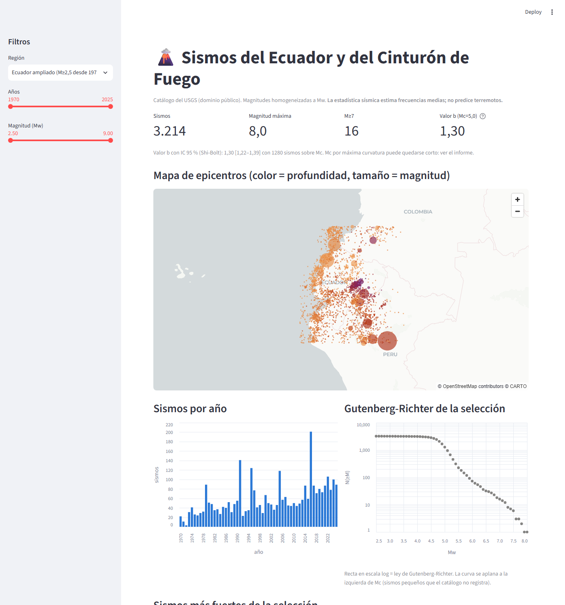 | 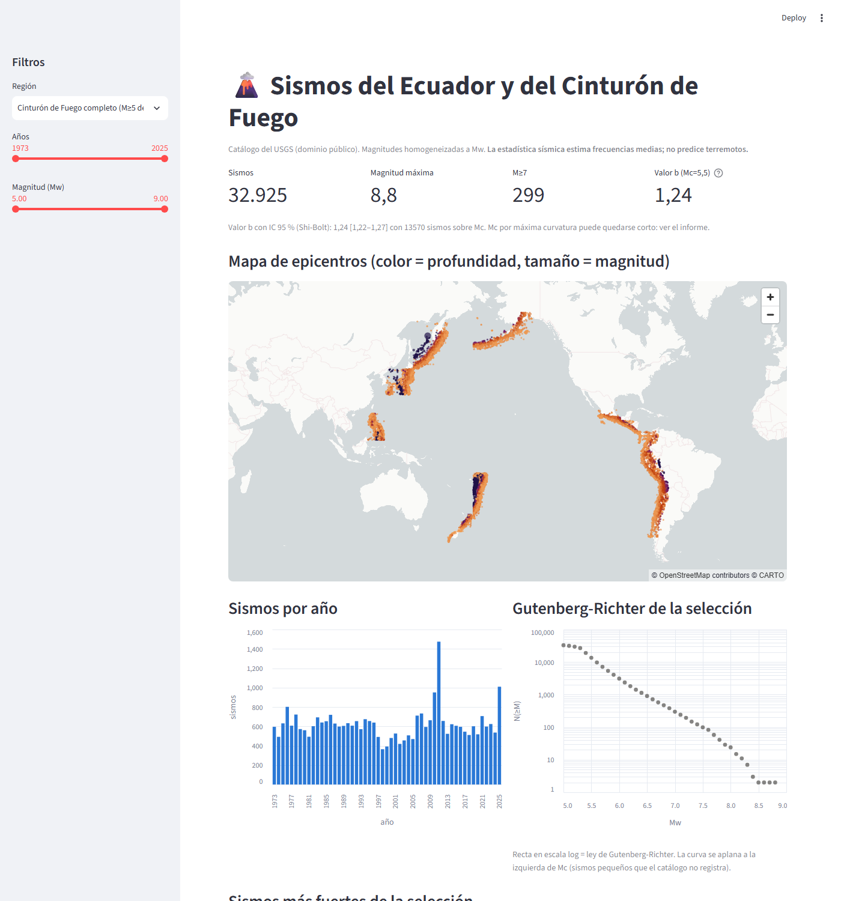 |

Guía detallada y preguntas de entrevista: [docs/GUIA_PASO_A_PASO.md](docs/GUIA_PASO_A_PASO.md).

## 📁 Estructura

```
sismicidad-ecuador-usgs/
├── descargar_datos.py          ← baja los catálogos (reanudable)
├── src/sismos/
│   ├── cliente_usgs.py         ← paginación, reintentos, pausa y caché
│   ├── descarga.py · calidad.py · desagrupar.py
│   ├── gutenberg_richter.py · retorno.py · omori.py
│   ├── analisis.py · graficos.py · pipeline.py
├── app/streamlit_app.py
├── notebooks/                  ← 01–05, ejecutados
├── data/procesados/            ← catálogos limpios en Parquet (5 MB, versionados)
├── data/muestra/               ← sismos de 2016–2017 para pruebas
├── reports/                    ← resultados.json, CSV, figures/, app/
└── tests/                      ← 38 pruebas; tests/grabadas/ = respuestas reales de la API
```

## 📚 Fuentes, referencias y licencias

* **USGS Earthquake Catalog (ComCat)**, FDSN Event Web Service: <https://earthquake.usgs.gov/fdsnws/event/1/> — **dominio público** (U.S. Government). Descargado el 22 de octubre de 2026 (UTC).
* **Límites de placas PB2002** (Bird, 2003, *G³* 4(3)), versión GeoJSON de <https://github.com/fraxen/tectonicplates> — ODC-By 1.0.
* **Natural Earth** 1:50m costas y fronteras: <https://www.naturalearthdata.com/> — dominio público.
* Aki (1965) · Utsu (1966) · Shi y Bolt (1982) · Gardner y Knopoff (1974) · Ogata (1983) · Cao y Gao (2002) · Woessner y Wiemer (2005) · Scordilis (2006, *J. Seismology* 10).

**Licencia:** el **código** de este repositorio es [MIT](LICENSE) (© 2026 Erick Guarnizo); los **datos** siguen la licencia propia de cada fuente, la citada arriba.
